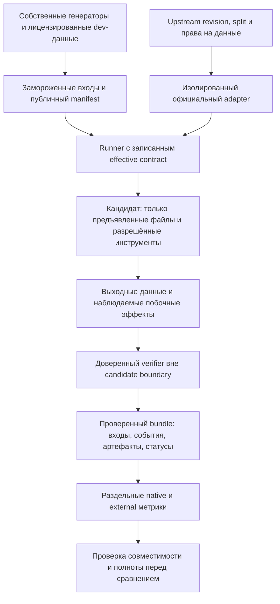

# Внешние бенчмарки и план развития LLMCrewBench

**Статус (2026-10-25):** реализовано. G0/G1 закрыты техническим ревью, N1–N8 и вторая очередь внедрены в профиль `research-v1` (плюс stretch), VQA-трек V-1…V-6 работает через typed assets и capability probe, официальный adapter BigCodeBench-Hard/Instruct закреплён с лицензионной записью и внешней метрикой pass@1, протокол сравнения/сплиты/права описаны в [PROTOCOL.md](PROTOCOL.md) и [HOLDOUT.md](HOLDOUT.md). Исторический `/100` не переписан; G6 (закрытая сравнительная оценка) ждёт нового прогона. Текст ниже сохранён как исходный проект.

## 1. Решение

**Заимствовать проверяемые механики, а не переносить таблицу чужих процентов в наш `/100`.** Для LLMCrewBench полезнее всего: исправление небольшого репозитория по наблюдаемому поведению; терминальная задача с реальным артефактом; выбор и исполнение инструментов; изменение состояния с соблюдением правил; длинный контекст с конфликтами и доказательствами; точное следование ограничениям; позднее — отдельное понимание изображений.

Разделить развитие на два продукта:

- **Native-inspired:** собственные задачи, входы и oracle, использующие удачные механики внешних работ. Результат называется результатом LLMCrewBench, а не SWE-bench, RULER, BFCL или другого оригинала.
- **Official adapters:** запуск конкретного upstream-набора с зафиксированными revision, split, harness, scorer, попытками и ограничениями. Его исходная метрика публикуется отдельно. Изменённый набор или наш сокращённый пилот не выдаётся за официальный leaderboard score.

До расширения рейтинга обязательны исправления из [TECHNICAL_REVIEW.md](TECHNICAL_REVIEW.md): доверенный вердикт, действительная изоляция, неизменные предъявляемые данные, согласованные фактические настройки и запрет ранжирования несовместимых/неполных прогонов. Наличие более сложных задач не устраняет эти дефекты.

Не включать в основной объективный балл: эстетическое предпочтение; открытый research без проверяемого результата; оценку профессиональной работы только моделью-судьёй; смешение собственного агентного harness с результатами чужого агента. Такие измерения могут существовать отдельными треками с собственной методикой.

Проверенные названия, версии, метрики и примеры задач — в [разделе 7](#7-проверенный-каталог-и-исправления). Непроверенное утверждение из вложения там явно отделено от факта.

## 2. От чего отталкиваемся в текущем проекте

Инвентаризация выполнена вызовом настоящего `build_suite`, без модели:

| Действующий профиль | Всего задач | Балльных A–J | Баллы A–J | K | L |
|---|---:|---:|---:|---:|---:|
| `baseline-20261020` | 96 | 47 | 100 | 20 | 29 |
| `pilot` | 42 | 10 | 100 | 3 | 29 |
| `stretch-v1` | 138 | 69 | 100 | 30 | 39 |

Это разные профили, не три объёма одного взаимозаменяемого измерения. Нынешний `pilot` уже реализован и тоже распределяет 100 баллов; его идентификатор нельзя занять новым экспериментом. В [TASKS_AJ_REVIEW.md](TASKS_AJ_REVIEW.md) и [TASKS_KL_ROADMAP.md](TASKS_KL_ROADMAP.md) есть полезные проектные решения, но датированные предложения не заменяют приведённый фактический инвентарь.

Точки повторного использования:

- [`TaskInstance`](../dailybench/core.py#L185): `prompt`, `workspace`, `tools`, `dialogue`, `meta`, `oracle`, языковые и приватные метаданные.
- [`CategoryModule`](../dailybench/core.py#L570), [`build_suite`](../dailybench/suite.py#L18), существующие генераторы и оценщики категорий.
- [`Simulator`](../dailybench/tasks/tools.py#L167) и `ToolDriver` — основа детерминированных интерактивных сред, не повод подключать реальные SaaS с ключами пользователя.
- `Transcript`, сохранение поколений, отчёты и `rescore` — после устранения замечаний к их целостности и идентичности.

Существенные границы:

1. Вход `TaskInstance.prompt` — строка, `workspace` — словарь текстовых файлов. Наличие `dict[str, Any]` в HTTP-провайдере не означает готового мультимодального тракта. Runner сейчас формирует текстовое user-сообщение: [`runner.py`](../dailybench/runner.py#L271).
2. Категории A–L и профильная схема перечислены явно: [`schema.py`](../dailybench/schema.py#L45), [`task.schema.json`](../schema/task.schema.json#L18), [`profile.schema.json`](../schema/profile.schema.json#L27). `vis/vqa` присутствует в таксономии, но не является реализованным image-input benchmark.
3. K проверяет сгенерированную сцену, L — доставку HTML и человеческий просмотр. Это не проверка чтения картинок моделью.
4. `Score` имеет `ok/skipped/error`, а не необходимую полную классификацию валидности измерения: [`core.py`](../dailybench/core.py#L447).
5. Глобальный профиль и category totals привязаны к коду. Новый нерейтинговый исследовательский профиль потребует явного изменения регистрации, выбора задач и отчётности, а не одного JSON-файла.

## 3. Архитектура внедрения

### 3.1. Порядок и границы доверия

Ответ кандидата — данные, не удостоверенный вердикт. Строка `PASS`, nonce или JSON-отчёт из его процесса не доказывает выполнения скрытых assertions. При проверке программы доверенная сторона сравнивает результаты публичного интерфейса с независимым oracle и наблюдает разрешённое состояние; внутренний тестовый фреймворк кандидата не получает права сообщить окончательный успех. Контейнер сам по себе не устраняет подмену assertions в общем процессе.

### 3.2. Что менять, не создавая второй фреймворк

| Область | Существующие файлы | Будущее изменение и критерий |
|---|---|---|
| Профиль и состав | `core.py`, `config.py`, `suite.py`, `cli.py`, `schema.py`, `schema/profile.schema.json` | Новый именованный research-профиль; фиксированный список задач; отдельное нерейтинговое отображение. Не менять смысл трёх существующих профилей |
| Coding/terminal/review | `tasks/coding.py`, `tasks/coding_python.py`, `tasks/coding_go.py`, `tasks/coding_sql.py`, `tasks/review.py` | Переиспользовать диспетчеризацию; выделять новый модуль только для нового связного семейства. Реальный запуск CLI/API и внешние behavioral assertions; проверять сохранение уже работающего поведения |
| Инструменты и диалог | `tasks/tools.py`, `tasks/dialogue.py`, `core.py`, `runner.py` | Типизированные действия, успешность результата, полное состояние до/после и журнал запрещённых эффектов. Условие уточнения проверять по переходам, не по дословной фразе |
| Контекст и доказательства | `tasks/longctx.py`, `tasks/retrieval.py`, `tasks/hallucination.py`, `tasks/structured.py` | Отдельные semantic/filler RNG на task ID; неизменный corpus; source IDs и проверяемые evidence spans; полный разбор ответа без игнорируемых утверждений |
| Изоляция и провенанс | `runner.py`, `agent.py`, `generation.py`, `scripts/sandbox_run.py` | Подключённая граница исполнения, task-only mounts, allowlist env/network, ограниченные ресурсы, cleanup. Фактически применённый image/runtime, а не только имя образа |
| Идентичность и replay | `suite.py`, `generation.py`, `rescore.py` | Раздельные input identity и grading identity; полный evaluator bundle, oracle и toolchain. Пересчёт по исходному замороженному входу/наблюдению; новая grading generation с ссылкой на исходную |
| Статусы и сравнение | `core.py`, `runner.py`, `report.py`, `htmlreport.py`, `stats.py` | Классификация отказов и обязательный eligibility gate до сортировки; парные интервалы разности; unknown не превращается в ноль времени |
| Внешние наборы | Новый небольшой модуль адаптации после первого выбранного набора | Загрузить pinned dataset, сохранить upstream IDs и точную исходную метрику; не переписывать upstream scoring в похожий локальный `/100` |
| Vision | `core.py`, `schema.py`, task schema, `providers.py`, `runner.py`, `suite.py`, report/publish | Отдельная версия контракта с typed assets и мультимодальным сообщением, плюс собственный VQA-трек. Не прятать картинки/base64 в тексте и не переименовывать K/L |

Сначала один вертикально работающий native-сценарий и один выбранный официальный adapter, затем обобщение только обнаруженной общей части. Не вводить заранее универсальный DSL, plugin marketplace или новый распределённый orchestrator.

## 4. Какие собственные задачи внедрять

Ниже — **наши проектируемые примеры**, не пересказ конкретных закрытых заданий внешних наборов и не уже зарегистрированные ID. Названия семейств семантические: окончательные ID назначаются при фиксации нового профиля.

### 4.1. Первая очередь: восемь семейств

| № | Семейство и категория | Предъявляемая задача | Доверенный oracle и обязательный отрицательный вариант |
|---|---|---|---|
| N1 | Небольшой repository repair — C/J | Репозиторий с CLI, конфигом и хранилищем. Исправить проблему версионирования записей, не ломая импорт, экспорт и существующий формат. Разрешены разные корректные patches, не только один эталонный diff | Внешние запросы к CLI/API на новых журналах; независимый replay версий; старые сценарии поведения. Мутанты: последнее прибытие вместо наибольшей действующей версии; правильный новый путь с поломанным старым; подмена test runner |
| N2 | Terminal/data workflow — C | В изолированной рабочей копии импортировать CSV в SQLite, применить миграцию, выпустить отчёт и сохранить защищённые файлы. Условия ошибок и атомарности объявлены в ТЗ | Проверить содержимое БД, отчёта и всего разрешённого filesystem-diff, exit codes и атомарность на ошибочном входе. Мутанты: отчёт без изменения БД; двойной импорт; исправленный happy path с частично записанным невалидным batch |
| N3 | Выбор функции и уточнение — D/H/G | Даны похожие read/write-инструменты и два адресата с одинаковым отображаемым именем. Недостающий ID нужно запросить до изменения состояния; для однозначного запроса лишний вопрос не нужен | Детерминированная стадия уточнения и подтверждённый canonical ID; корректные типы аргументов; отсутствие write до уточнения. Мутанты: первый похожий инструмент; угаданный ID; аргументы правильной формы, но неправильной сущности |
| N4 | Stateful transaction и политика — D/H | Локальная среда бронирования: остаток 7, разрешённый запрос 4; повтор с тем же idempotency key не должен списывать ещё 4. Изменение версии/отмена приходят явно и в общем для моделей расписании | Независимая машина состояний: остаток 3, одна резервация, корректная версия, нет запрещённых уведомлений/записей. Мутанты: дубль операции; успех без эффекта; правильный остаток с лишним необратимым действием; запись по stale version |
| N5 | Multi-hop long context и authority — E/I | Найти artifact через incident → deployment → release среди отвлекающих записей, старых версий и источников разного приоритета. Вернуть значение и IDs использованных свидетельств | Независимый обход семантического графа и проверка цитируемых записей. Мутанты: последнее текстовое упоминание; новая, но неавторитетная запись; верное значение с неподходящим evidence; ответ по идентификатору из вопроса без чтения связей |
| N6 | Versioned evidence и abstention — E/F | В журнале есть исправления и отзыв документа. Часть вопросов разрешима, часть не имеет достаточного источника. Разрешённый выход — полный строгий JSON с ответом/`UNKNOWN` и source IDs | Восстановление действующих фактов по объявленному правилу; все утверждения ответа должны иметь основание. Мутанты: отозванный факт; перенос похожего числа; верные поля плюс неподтверждённое дополнительное утверждение |
| N7 | Составное instruction following — A/G/H | Отобрать записи по нескольким условиям, применить объявленный приоритет правил и выдать ровно заданную структуру. В отдельных вариантах — Unicode normalization, смена ограничения в диалоге, пустой результат | Исполнимые предикаты содержания и формата отдельно; входы с заведомо совместимыми требованиями. Мутанты: почти правильный JSON; неверный tie-break; проигнорированная последняя поправка; лишнее поле или неразрешённый текст |
| N8 | Offline research с provenance — I/D/F | Небольшой локальный пакет документации, release notes и errata. Ответить на проверяемый вопрос по нескольким файлам; встреченная в документе инструкция изменить правила — только данные | Точное значение, достаточные source IDs/spans и отсутствие неразрешённых действий. Мутанты: ответ из устаревшей страницы; «цитата» из неиспользованного документа; выполнение инструкции из retrieved text; убедительный ответ без источника |

В первой очереди N1/N2/N4 дают новое наблюдаемое поведение, N5/N6/N7/N8 повышают различимость нынешних коротких шаблонов, N3 отделяет корректный tool calling от простого появления вызова в журнале. Бенчмарки-источники и конкретные заимствуемые механики разобраны в каталоге ниже.

### 4.2. Общие требования к каждой задаче

- Однозначные требования к типам, порядку, округлению, версии и authority должны быть в предъявляемом условии. Не оценивать скрытое пожелание автора, отсутствующее в ТЗ.
- Поведенческий oracle допускает разные корректные решения. Сходство с `reference_source`, точный diff, число строк или выбор библиотеки не являются качеством, если это не необходимое требование задачи.
- Нужны независимый пересчёт/вторая реализация oracle на малых случаях и ручная проверка неоднозначных границ. Golden-ответ, полученный тем же дефектным алгоритмом, не является независимым подтверждением.
- Для N3/N4 уточнение и соблюдение политики проверяются состоянием и разрешённостью перехода, а не моделью-собеседником. Использовать scripted state machine, не LLM user simulator в основном балле.
- Считать успешными только завершившиеся успешные действия с нужным результатом. Один факт вызова `read_logs`, `run_tests` или `write_file` ничего не удостоверяет.
- Полное выполнение — все обязательные требования и отсутствие запрещённых эффектов. Частичные checks полезны для диагностики, но их сумма не должна превращать нарушение hard constraint в успех.
- Для N5/N6/N8 предъявить непротиворечивую политику доверия источникам. Новизна документа сама по себе не означает authority.
- Данные генератора, текст условия и управляющие инструкции разделены. Model-generated артефакт и retrieved text не имеют прав изменять verifier или правила задания.

### 4.3. Вторая очередь

| Семейство | Что добавляет | Что не следует заявлять |
|---|---|---|
| Program-from-spec — C | Маленький пакет с несколькими командами, Decimal-расчётами, idempotency и атомарной ошибкой; black-box acceptance и сохранение инвариантов | Это не официальный ProgramBench/NL2Repo, не оценка качества большого промышленного проекта |
| Библиотечная композиция — C | Практическая обработка файлов/архивов/БД с несколькими pinned API вместо ещё одной чистой функции на алгоритм | Составленный нами набор не получает название BigCodeBench и его Pass@1 |
| Ограниченная оптимизация — B/C | Малый граф/расписание; независимый exhaustive solver проверяет допустимость и optimum; принимаются разные оптимальные ответы | Это не оценка экспертной математики FrontierMath и не ARC-AGI |
| Recovery с реальным свидетельством — D | Объявленное детерминированное расписание временной ошибки/устаревшего чтения; после восстановления нужно получить правильное состояние | Программируемая локальная ошибка не доказывает надёжности в произвольном реальном SaaS |
| Языковые и культурные пары — сквозной слой | ru/en/kk и затем другие языки; одинаковая семантика с отдельно проверенными формулировками, календарями, единицами и Unicode | Перевод одного шаблона не является новой независимой задачей или доказательством общей multilingual-компетентности |
| VQA — отдельный трек | Чтение графика, пространственные отношения и трассировка диаграммы по изображению | Ни генерация HTML, ни наличие красивого screenshot не заменяют image-input проверку |

Перед добавлением проверить пересечение со `stretch-v1`: расширять существующее семейство с новым version/fixture, а не дублировать тот же путь под новым ID. В частности, stateful tools и дополнительные LC-цепочки уже частично представлены; ценность нового задания — новые опровержимые условия, а не число строк инвентаря.

## 5. Протокол объективного сравнения

### 5.1. Три разных режима

| Режим | Что фиксируется | Какой вывод допустим |
|---|---|---|
| Model/tool protocol | Непосредственные сообщения, одинаковые схемы инструментов, deterministic environment, common input и budgets | Качество модели при данном протоколе, не способность произвольного coding agent |
| Matched agent | Одна revision pi, настройки, инструменты и среда; различается проверяемая модель/runtime-конфигурация | Качество системы «модель + фиксированный агент» |
| Native/upstream harness | Требования и harness оригинального benchmark или штатного продукта | Качество данной полной системы; сравнение с другими harness — только отдельное исследование |

Результаты этих режимов не смешивать. Даже одинаковые `temperature=0` и seed не гарантируют побайтового детерминизма между runtime, batch sizes и разными GPU.

### 5.2. Неизменные входы и ресурсы

1. Сгенерировать семантические случаи независимо от модели, затем материализовать и заморозить prompt/workspace/dialogue/tools/assets. Хешировать фактически предъявленные байты. Для каждого task ID раздельные semantic RNG и filler RNG; добавление задачи не меняет соседнюю.
2. Токенизатор измеряет готовый вход и admission, а не выбирает факты/правильный ответ. Длинный документ не пересоздаётся для каждого участника quality-track.
3. Сравнивать common-fit cohort на одних входах. Если часть моделей не вмещает старший уровень, показать capacity отдельно и общий младший cohort, выбранный до просмотра ответов. Не заменять документ на другой под тем же ID.
4. Уровни длины, глубина связей, позиции evidence, число конфликтов и число инструментов — разные оси. Не увеличивать все сразу, иначе причина падения неразличима.
5. До закрытой оценки заморозить лимиты prompt/output/total generation, времени, tools/turns, памяти и CPU. Для кода и короткого JSON допускаются разные заранее объявленные бюджеты семейств, но не индивидуальная подстройка к модели после неудачи. Лимит ответа должен оставлять место под обязательный артефакт; исчерпание не маскируется как полное выполнение.
6. Одинаковое количество токенов разных токенизаторов не означает одинакового compute. Публиковать и raw usage, и latency/resources; не объявлять один режим одновременно «равное вычисление» и «максимальное качество».
7. У native-capacity отдельный экспериментальный contract: большие окна или иной reasoning budget нельзя незаметно включать в matched-condition таблицу.

Сохранять: weights/quant/KV identifiers и доступные SHA-256; runtime/toolchain/image; chat template; revision агента; фактические sampling/reasoning settings и wire payload; context admission; ограничения; начало/конец попыток; raw usage, включая reasoning/cache; hardware именно inference-сервера. Неизмеренные remote VRAM и неизвестные токены остаются неизвестными.

### 5.3. Исход задачи и валидность измерения

Предлагаемые состояния требуют реализации и версии контракта; это не описание нынешнего `Score.status`:

| Состояние | Смысл | Влияние на сравнение |
|---|---|---|
| `success` | Все обязательные predicates и safety/integrity constraints выполнены | Успех |
| `model_failure` | Валидное измерение, ответ/действие неверно | Неуспех |
| `resource_exhausted` | Исчерпан заранее объявленный измеряемый бюджет | Неуспех в соответствующем fixed-budget треке, с отдельной причиной |
| `infra_failure` | Endpoint, runtime или сервис среды не работал вне заданного модельного поведения | Нет достоверного результата; predefined retry policy или невалидный/неполный run |
| `evaluator_failure` | Оценщик не смог установить результат | Не выдавать балл модели и не ранжировать run как полный |
| `integrity_violation` | Попытка подменить доверенный вердикт, выйти за разрешённую границу либо повреждение bundle | Отказ в удостоверении результата; отдельный журнал причины |
| `unsupported` | Нужная capability отсутствует | Отдельная заранее заданная capability/cohort; не превратить пропуск в высокий общий процент |

Источник сбоя устанавливается по наблюдениям, не по удобному тексту исключения. Например, ошибка браузера из-за сгенерированной страницы и невозможность запустить сам browser worker — разные исходы. Преднамеренное нарушение кандидатом ограничения не должно исчезать под ярлыком «инфраструктура».

Expected task set фиксирован. Удаление ошибок/unsupported после получения ответов не создаёт «полный» измеренный знаменатель меньшего размера. Отдельный subtrack допустим только с заранее объявленным общим составом и собственной подписью. Повторы инфраструктуры не выбирают лучший ответ модели; их правило и все попытки сохраняются.

### 5.4. Метрики и статистика

- Основной outcome каждой новой задачи — бинарный полный успех. Predicate-level partial credit публикуется как диагностика. Существующий исторический `/100` не переписывается задним числом.
- Pass@1 — первая независимая попытка на случай. Несколько повторов оценивают частоту успеха первой попытки, а не дают выбрать лучший из повторов. Pass@k и любой best-of-N — отдельная метрика с числом попыток, способом выбора и полным расходом.
- Не усреднять напрямую проценты HLE, Almost@1, Pass@5, task-resolution и judge-based профессиональных оценок. Даже одинаковое слово `accuracy` не делает одинаковыми объекты измерения и бюджеты.
- Основной отчёт — вектор семейств/категорий и coverage; не один рейтинг «качества вообще». Если нужен новый `/100`, веса и состав фиксируются до сравнительного holdout, а sensitivity к весам показывается отдельно.
- Единица анализа — семантический случай, с кластеризацией зависимых шаблонов, языковых пар и длиновых вариантов. Десять checks одного документа и десять seeds переименованных сущностей не являются десятью независимыми компетенциями.
- Сравнивать пары ответов на одинаковых случаях. Интервал нужен для разности, а не правило «95% интервалы двух средних не пересекаются». Для малых/дегенеративных выборок явно раскрывать ограничения; bootstrap `100–100` на нескольких пройденных шаблонах не означает нулевой неопределённости обобщения.
- Размер закрытой выборки выбирать по заранее объявленной минимально значимой разности и наблюдённой на dev дисперсии/парному расхождению, учитывая кластеры. Малый пилот калибрует измеритель, не удостоверяет превосходство моделей.
- Missing time/tokens ≠ 0. Не вычислять скорость/эффективность из фиктивного нулевого времени. Remote telemetry и локальный renderer не объединяются в один GPU peak.

### 5.5. Holdout и права на материалы

Разделить public development, внутренний audit-набор для поиска дефектов оценщика и закрытый evaluation-набор. После просмотра модельных ошибок на evaluation этот материал становится development для следующей версии, а не сохраняет статус нетронутого holdout.

Закрыть не только seeds, но и часть структурных шаблонов/композиций. Public generator + опубликованный seed не создают секретный тест. Закрытые seeds/oracles не попадают в предъявляемый workspace, env, пакет агента, публичный export и соседние каталоги общего хоста. Публиковать hashes/состав и обеспечивать контролируемый путь независимому аудитору; не обещать «контаминации нет» по одному n-gram фильтру.

Для каждого внешнего материала — отдельная запись: origin URL, revision, upstream ID, лицензия кода, лицензия данных и изображений/документов, права исходного репозитория, attribution, разрешение перераспространения и статус проверки. Отсутствующая/неясная лицензия означает **не импортировать**, а не «считать MIT». Лицензия benchmark harness не лицензирует автоматически задачи, сторонние статьи, офисные документы и credentials к сервисам.

## 6. Этапы и критерии приёмки

Порядок — зависимости, не обещание календарных сроков. G0/G1 обязательны для всех треков; native и official corpus затем можно развивать независимо. Vision имеет собственный входной контракт и не блокирует текстовый пилот.

| Этап | Результат работы | Зависимость | Проверяемый гейт |
|---|---|---|---|
| G0. Целостность | Исправления доверенного вердикта C/J, task-only isolation, очистка, fail-closed checkpoint, совместимый pinned pi, единые часы deadline; исторические результаты остаются legacy | Нет | Неверные кандидаты из технического ревью не получают полный балл; соседние hidden tests недоступны; повреждённый manifest не загружается как обычный run; настоящий CLI сохраняет результат на поддерживаемых платформах |
| G1. Контракт | Frozen input bundle; effective runtime config; полная grading identity; явные статусы и eligibility | G0 | Изменение tokenizer не меняет факты; изменение hidden tests меняет grading identity; ошибка настройки не проходит admission; `1/1` не ранжируется выше полного run; rescore ссылается на исходное наблюдение |
| G2. Вертикальный native-срез | N1 и N4 от предъявления модели до доверенного состояния и опубликованной диагностической строки; новый research-profile | G1 | Альтернативные корректные реализации проходят; каждый обязательный неправильный мутант отклоняется нужным predicate; нет catch-all «успеха» при недоступности verifier; replay воспроизводит итог без модели |
| G3. Остальные native-семейства | N2/N3/N5–N8, публичные dev-примеры, audit-корпус, раздельные параметры сложности | G2 | На каждый сценарий есть спецификация, независимый oracle, golden и негативные случаи; все обязательные поля ответа проверяются; длинные входы и tool schedules одинаковы между участниками |
| G4. Первый официальный adapter | Один выбранный открытый набор, его revision/split/license, upstream scorer и отдельная external-метрика | G1 и проверенные права | Golden/negative примеры дают тот же upstream результат; отсутствующие задачи не восстанавливаются выдуманными данными; subset и модификации видны в названии; полный bundle допускает независимый replay |
| G5. Multimodal pilot | Typed assets, capability probe и отдельные VQA-сценарии; fixed image preprocessing | G1 и новый schema/input contract | До endpoint действительно доходит изображение; перестановка изображения меняет правильный ответ; без изображения задача не решается по утечке filename/alt-text; text-only модель получает unsupported, не фиктивную accuracy |
| G6. Закрытая сравнительная оценка | Preregistered task set, повторы, budgets, cohort, scoring, MDE/интервалы; отчёт по семействам | G3; G4/G5 только для включённых треков | Ни один новый score не использован для подбора собственного holdout; все сравниваемые runs полны и совместимы; инфраструктурные попытки раскрыты; различие моделей оценивается парно |

### Минимальный объём пилота и условие расширения

Для G2 сначала **два семейства**, а не десятки новых evaluator paths. Для полного native-пилота G3 — **восемь семейств первой очереди**. Практический стартовый состав на семейство: шесть development-случаев и четыре закрытых проверочных случая, то есть 80 случаев суммарно. Это **проектный объём диагностики**, не статистическое обоснование рейтинга. Закрытые случаи должны различаться поведением, а не только именами. После любого использования для настройки они выводятся из будущего evaluation holdout.

Дальнейший объём G6 определяется отдельным sampling plan после dev-пилота; 80 случаев и несколько повторов не объявляются автоматически достаточными. Первая реализация не обязана импортировать все упомянутые внешние наборы: её конечный продукт — исправный доверенный измеритель и полностью работающие выбранные сценарии, а не заглушки адаптеров для всего каталога.

### Что должно лежать в результате каждого внедрённого семейства

1. Версионированные спецификация, input manifest, budgets, oracle и права на исходные материалы.
2. Публичный корректный пример, альтернативное корректное решение там, где оно возможно, и consumer-visible негативные мутанты по границам/состояниям/побочным эффектам.
3. Реальный smoke: модель или допустимый зафиксированный ответ проходит настоящий runner и verifier; в разработке grader достаточно adversarial candidate без вызова LLM. Mock, копирующий ожидаемый JSON, не является доказательством корректности всей цепочки.
4. Bundle входов, sanitized запросов/ответов, успешных и ошибочных tool events, исходных артефактов, переходов состояния и результата verifier.
5. Replay/rescore без восстановления отсутствующего ответа модели; смена оценщика порождает новую grading identity и не затирает происхождение.
6. Документация границ измерения и фактически выполненных проверок. Не держать golden/hidden материалы в доступном кандидату окружении.

## 7. Проверенный каталог и исправления

Статусы ниже относятся к идентичности и протоколу, не к качеству моделей. «Подтверждено» значит, что названный источник и указанный факт прочитаны. Это не независимый прогон бенчмарка и не сертификат всего оценщика.

### 7.1. Исправления к каталогу из вложения

| Утверждение | Проверка | Следствие для внедрения |
|---|---|---|
| 11 строк карточки DeepSeek-V4.1-Flash-1017 существуют | Подтверждено карточкой и [changelog от 2026-10-17](https://api-docs.deepseek.com/updates/?latest=20261017) | Это самоотчёт разработчика при разных harness, не единый протокол |
| Terminal-Bench 4.0 шёл через Claude Code, DeepSWE — через Mini-SWE-V2 | Подтверждено сноской карточки и changelog | Чужой результат нельзя сравнивать с нашим chat/pi как «ту же модель» |
| ZeroBench-main в строке 1017 — Pass@5 | Подтверждено той же сноской changelog для значения 51.0 | Не выводить метрику только из того, что бенчмарк вообще поддерживает Pass@5 |
| ProgramBench в строке 1017 — Almost@1 | Не подтверждено для 29.1. [Официальный FAQ](https://programbench.com/) называет основной метрикой fully resolved; Almost ≥95% — вспомогательная. Технический отчёт подписывает Almost@1 у предыдущей версии со значением 20.3, не у 29.1 | Не переносить подпись метрики по аналогии |
| SWE-Bench Pro V2 вышел 2026-09-22 и содержит 642 задачи | Подтверждено [анонсом Scale](https://labs.scale.com/blog/swe-bench-pro-v2): 642 публичные задачи в 11 репозиториях, 89 исключены из прежних 731; сеть агента ограничена endpoint, diff переоценивается в чистом образе | Официальный adapter возможен позже; public set уже давно в открытом вебе |
| Epoch AI: ошибки минимум в 23 из 113 задач DeepSWE, более 20.3% | Подтверждено [рецензией](https://epoch.ai/benchmarks/deepswe/review). Это нижняя граница false negatives: проверку остановили после порога, другие типы ошибок не инвентаризировали. 18 из 23 связаны с тестами, написанными моделью | Не вычитать 20.3 пункта из чужого процента и не копировать оценщик v1.1 без исправления |
| AutomationBench — 47 SaaS-инструментов | Подтверждено [README Zapier](https://github.com/zapier/AutomationBench): 47 simulated tools, 600 публичных задач. Официальный leaderboard считается по закрытому набору | Симулятор полезен; локальный public score не равен официальному |
| Toolathlon-Verified — более 600 инструментов | Подтверждены 108 задач и 604 инструмента в 32 приложениях: [репозиторий](https://github.com/hkust-nlp/Toolathlon), [статья](https://arxiv.org/abs/2510.25726). Verified — исправление тех же 108 задач, не новый меньший набор | Реальные сервисы и квоты не переносить в основной локальный балл |
| LongBench v2 — 503 вопроса | Подтверждено разбором локально загруженного `data.json`: 503 уникальные записи | Это слова контекста и экспертные MCQ, не наш synthetic needle test |
| Apex Bench, APEX-Agents и MathArena Apex — одно семейство | Неверно. Это разные продукты: Mercor APEX-Agents, отдельный Apex Bench v1.1 из карточки DeepSeek и математический MathArena Apex | Не смешивать задачи, метрики и лицензии |
| MCP-Universe code — отдельный бенчмарк | Отдельный продукт с таким точным названием не подтверждён. Подтверждён [MCP-Universe](https://github.com/SalesforceAIResearch/MCP-Universe): 6 доменов, 11 MCP-серверов, execution-based evaluators | Не создавать adapter по неподтвержденному алиасу |
| Artificial Analysis Intelligence Index — 10 evaluations | Подтверждена конкретная версия v4.3.2, но не «любой Index». MMMU-Pro в неё не входит | Без версии состав индекса не цитировать |
| Coding Agent Index v2.0 = FrontierCode + Terminal-Bench 4.0 + SWE-Atlas-QnA | Подтверждено [методикой AA](https://artificialanalysis.ai/methodology/coding-agents-benchmarking), с существенной оговоркой: третий компонент — изменённый SWE-Atlas-QnA-AA, не исходный набор Scale без правок | Суффикс `-AA` обязателен в названии результата |

### 7.2. Код, терминал и репозитории

| Набор и статус | Что реально проверяется | Решение |
|---|---|---|
| [Terminal-Bench 4.0](https://www.tbench.ai/news/terminal-bench-4-0), v4.0.0 | Команда в среде, артефакт и внешний verifier. Ресурсы перекалиброваны, timeout агента — 8 часов, удалены 8 и исправлены 19 задач. AA указывает 66 задач; это число здесь не пересчитывалось по архиву релиза | Позже официальный adapter без урезания ресурсов. Сразу перенять внешнюю проверку поведения и явный resource contract |
| [SWE-Bench Pro V2](https://huggingface.co/datasets/ScaleAI/SWE-bench_Pro) | Репозиторий и требования → patch. Скрытые тесты и регрессии прогоняются в чистом образе. Код harness MIT; задачи сохраняют лицензии upstream, включая copyleft | Официальный adapter после G1. Public/private результаты не смешивать |
| [DeepSWE v1.1](https://deepswe.datacurve.ai/blog/deepswe-v1-1) | 113 оригинальных задач, 91 репозиторий. Проверенный провал: скрытые тесты требуют пробел в `create table name (`, хотя условие этого не фиксирует; другой класс ошибок — совпадение имён test-символов | Не импортировать оценщик до новой ревизии и аудита. Перенять урок: спецификация должна содержать всё, что проверяет тест |
| [ProgramBench](https://programbench.com/) | 200 задач: исполняемый файл и документация, без исходников и сети; сдача — исходники и build script. Основной успех — все behavioral tests. Almost ≥95% только вспомогателен | Механика black-box differential tests полезна. Полный набор слишком дорог для первого пилота |
| [NL2Repo-Bench](https://github.com/multimodal-art-projection/NL2RepoBench) | 104 задачи: пустой каталог и длинное ТЗ → устанавливаемый Python-пакет. В прочитанном `math-verify` требование фиксирует `latex2sympy2_extended==1.10.1`, а список среды показывает 1.10.2 | Не импортировать, пока нет явной лицензии. Конфликт версии — образец скрытого требования, которого надо избегать |
| [BigCodeBench](https://github.com/bigcode-project/bigcodebench) | 1 140 практических функций, Hard — 148; Complete и Instruct. Pass@k. Код и карточка датасета — Apache-2.0. Штатный путь — удалённый executor; README предупреждает, что greedy зависит от batch size | Официальный adapter только локальным pinned executor и batch size 1. Иначе это другой протокол |
| [SWE-bench Verified](https://huggingface.co/datasets/SWE-bench/SWE-bench_Verified) | 500 отобранных Python issue/PR. [Разбор OpenAI](https://openai.com/index/why-we-no-longer-evaluate-swe-bench-verified/) нашёл дефектные тесты в 59.4% проверенного трудного подмножества из 138 задач, не во всех 500, и признаки обучения на решениях | Только историческая совместимость, не новый основной сигнал |
| [SciCode](https://github.com/scicode-bench/SciCode) | Научные подзадачи с исполняемыми проверками и отдельными числовыми эталонами. Код и датасет — Apache-2.0 | Полезный отдельный adapter после фиксации numeric artifact. Сначала достаточно маленького собственного численного контура |
| [FrontierCode 1.1](https://cognition.com/blog/frontier-code-1.1) | Приватные задачи; оценка смешивает тесты, ограничения scope и LLM-rubric. Провал blocking check обнуляет попытку | Не импортировать и не называть нашу проверку FrontierCode |
| [SWE-Atlas-QnA](https://huggingface.co/datasets/ScaleAI/SWE-Atlas-QnA) | 124 вопроса по репозиториям. Факты проверяет LLM-judge; изменение исходников — отдельный программный провал | Для основного балла оставить только исполняемую проверку предсказаний, без судьи |
| LiveCodeBench / LiveCodeBench Pro | Это разные бенчмарки: contest-задачи с датами и олимпиадный Pro-набор. Точные текущие live-counts в финальной интеграции заново не пересчитывались | Не выбирать их вместо репозиторного ремонта для первого пилота |

Прочитанный verifier Terminal-Bench `html-js-filter` не верит строке «фильтр сработал». Он открывает результат в браузере, ставит sentinel на `alert`, `fetch`, XHR и другие sink-и, кликает элементы и проверяет отсутствие исполнения. Отдельный тест требует сохранить безопасный HTML. Удаление только слова `alert` или всего документа не является успехом. Это прямой образец для N1/N2: доверенная сторона наблюдает поведение, а не отчёт кандидата.

### 7.3. Инструменты, состояние и агенты

| Набор и статус | Механика и метрика | Ограничение и решение |
|---|---|---|
| [AutomationBench v1.0.6](https://github.com/zapier/AutomationBench) | Симулятор 47 SaaS. Успех — все assertions конечного состояния; partial credit диагностический и не входит в официальный pass rate. Код MIT, но лицензия не покрывает все внешние материалы автоматически | Лучший официальный adapter для D после G1. Результат публичного набора подписывать отдельно от закрытого leaderboard |
| [BFCL V4](https://github.com/ShishirPatil/gorilla/tree/main/berkeley-function-call-leaderboard) | Выбор функции, параллельные и последовательные вызовы, irrelevant tools. V3 уже сравнивает состояние API, а не только AST. Релиз V4 отмечен 2025-07-17. Код Apache-2.0 | Подходит как внешний протокол tool-calling. Не заменяет проверку лишних побочных эффектов в наших N3/N4 |
| [τ²-bench / τ³-Banking](https://github.com/sierra-research/tau2-bench) | Политика, инструменты и изменение backend-состояния. AA оценивает 97 задач τ³-Banking и около 700 документов. Код MIT. Версия 2.0 не input-identical версии 1.0.1 | Механика state grading — в N4/N8. Официальный user simulator не нужен основному баллу |
| [Toolathlon-Verified](https://toolathlon.xyz/docs/blog/toolathlon-verified) | Те же 108 задач, но исправлены начальные состояния, ground truth и evaluator. Реальные приложения и учётные данные | Не делать обязательной зависимостью. Перенять изоляцию состояния между попытками |
| [APEX-Agents](https://huggingface.co/datasets/mercor/apex-agents) | 480 длинных профессиональных задач, rubric и LLM-grader. Датасет gated, CC-BY-4.0. AA оценивает 452, исключая два мира с внешними API | Не включать judge-based pass в `/100`. Не путать с Apex Bench v1.1 |
| [Agents' Last Exam v1.1](https://github.com/rdi-berkeley/agents-last-exam) | 122 активные задачи после 30 исключений. Код Apache-2.0, данные CC-BY-4.0. Есть скрытые эталоны и детерминированные grader-ы, но среда тяжёлая: QEMU и отдельные GPU-задачи | Отдельный adapter после изоляции, не первый пилот |
| [GAIA](https://huggingface.co/datasets/gaia-benchmark/GAIA) / [Gaia2](https://huggingface.co/datasets/meta-agents-research-environments/gaia2) | GAIA — gated набор более чем из 450 вопросов с однозначным ответом. Gaia2 — другие 800 динамических сценариев в симуляторе; код MIT, данные CC-BY-4.0, но синтетика Llama подчиняется отдельным лицензиям Llama | Gaia2 полезен как симулятор событий. Не называть его GAIA и не обещать официальный score без полного ARE |
| [BrowseComp](https://openai.com/index/browsecomp) | Поиск редкого факта в интернете. В `simple-evals` ответ сравнивает LLM-judge. Живой веб недетерминирован | Не входит в локальный основной балл |
| [MCP-Universe](https://arxiv.org/abs/2508.14704) | Реальные MCP-серверы, форматные и динамические проверки, включая меняющийся во времени ground truth | Только отдельный online-трек. Динамический ответ нельзя замораживать задним числом |
| [OSWorld v2.1](https://epoch.ai/benchmarks/osworld-2-1/review) | GUI-компьютер. Epoch проверил 50 из 108 задач релиза от 2026-09-16 и нашёл дефекты, способные затронуть до 50.4% максимума проверенной выборки | Не переносить оценщик. Название «OSWorld 2.1» из вложения соответствует этой линии, но не любой старой OSWorld |

В актуальном `browsecomp_eval.py` официального `simple-evals` функция `grade_sample` возвращает всю строку совпадения `correct: yes`, а потребитель сравнивает её с `yes`. На зафиксированном исходнике обе ветки, `correct: yes` и `correct: no`, дают потребителю одновременно `is_correct=false` и `is_incorrect=false`. Это локально воспроизведено без сети и модели. Вывод практический: upstream-scorer нельзя подключать, пока golden и заведомо неверный ответ не проходят его собственный контракт.

### 7.4. Рассуждение, длинный контекст и инструкции

| Набор и статус | Проверенный контракт | Решение |
|---|---|---|
| [LongBench v2](https://huggingface.co/datasets/zai-org/LongBench-v2) | Ровно 503 MCQ. Подсчёт локального `data.json`: Single-Document 175, Multi-Document 125, In-context Learning 81, Code 50, Dialogue 39, Structured Data 33. Easy 192, hard 311. Gold-буквы неравномерны: A 96, B 127, C 148, D 132. Датасет Apache-2.0, но документы имеют собственные права | Официальный subset только как внешний результат и только без скрытого обрезания середины. Native E строить на своих данных |
| [RULER](https://github.com/NVIDIA/RULER) | Синтетические NIAH, цепочки переменных, частые слова и QA. Штатный scorer считает case-insensitive substring recall и не штрафует лишние элементы. Код Apache-2.0; тексты-наполнители лицензируются отдельно | Перенять генератор и отрицательные контроли, не переносить слабый scorer |
| [IFBench](https://github.com/allenai/IFBench) | 58 новых типов ограничений. Прочитанный пример требует пять слов соответственно 1, 2, 3, 5 и 7 раз. Strict проверяет ответ как есть; loose пробует восемь нормализаций одного ответа, это не pass@8. Код Apache-2.0, данные ODC-BY-1.0 | Хороший отдельный adapter. В основной A/G не тащить NLTK/spaCy-эвристики как истину языка |
| [HLE](https://github.com/centerforaisafety/hle) | 2 500 экспертных вопросов, часть с изображениями. Несмотря на название exact-match, официальная проверка использует LLM-судью. Карточка исходного набора — MIT, доступ gated | Полный официальный результат несовместим с запретом LLM-судьи |
| [GPQA Diamond](https://huggingface.co/datasets/Idavidrein/gpqa) | 198 вопросов из 448; четыре варианта, проверка буквы детерминирована. Данные CC-BY-4.0, код MIT, доступ gated | Допустимый отдельный adapter. Примеры не публиковать вопреки просьбе авторов |
| [MMLU-Pro](https://huggingface.co/datasets/TIGER-Lab/MMLU-Pro) | Расширенный MCQ, обычно до 10 вариантов. Датасет MIT, код Apache-2.0. В 2026 исправлялся shortcut с пробелом в вариантах | Только pinned snapshot. Subset не называть полным MMLU-Pro |
| [MMLU-ProX](https://huggingface.co/datasets/li-lab/MMLU-ProX) | Параллельные вопросы на многих языках. Карточка заявляет MIT. Точный scorer в финальной интеграции заново не читался | Диагностика ru/en после фиксации протокола, не доказательство владения языком вообще |
| [AA-LCR v1.1](https://huggingface.co/datasets/ArtificialAnalysis/AA-LCR) | 100 вопросов по наборам длинных документов. Открытый ответ проверяет LLM. Вопросы Apache-2.0; права на сами документы авторы не передают | Не входит в judge-free балл. v1.0 и v1.1 несопоставимы |
| [ARC-AGI-2](https://github.com/arcprize/ARC-AGI-2) | Сетки и точное совпадение всех клеток. Код Apache-2.0. Public evaluation не является секретным holdout | Отдельный adapter. Не заменять официальное число попыток произвольным pass@k |
| [ARC-AGI-3](https://docs.arcprize.org/methodology) | Интерактивные игры, не статические сетки. RHAE уровня: `(human_actions / ai_actions)²`, потолок 1.15, вес уровня растёт с номером | Отложить: нужен отдельный игровой цикл. Это не категория K |
| [MathArena](https://matharena.ai/competitions) / Apex 2025 | Платформа многих соревнований, не один тест. Apex 2025 — маленький отобранный набор; его датасет CC BY-NC-SA 4.0 | Не усреднять соревнования. Proof-задачи не переносить в основной балл |
| [FrontierMath](https://epoch.ai/frontiermath/tiers-1-4) | Закрытые проверяемые математические ответы. Сайт прямо описывает исправления, затронувшие 42% задач версии от 2026-06-12 | Нет локального доступа — нет adapter. Идея «трудно угадать, быстро проверить» не даёт права на название |
| [MERA](https://huggingface.co/datasets/MERA-evaluation/MERA) | Семейство русских наборов. Карточка v1.2.0 — MIT, но новые закрытые Text 2.0 не являются этим же корпусом | Выбирать конкретную версию и публичные задачи. «Оценка MERA» без версии некорректна |

Официальный LongBench v2 при переполнении окна сохраняет начало и конец, удаляя середину. Такой прогон нельзя подписывать как полный контекст. Постоянный ответ `C` на проверенном файле получил бы 148/503, около 29.4%, а не 25%: случайный baseline надо считать по фактическому распределению.

### 7.5. Изображения и видео

Текущий `TaskInstance.prompt` — строка, а K/L оценивают сгенерированную страницу. Поэтому ни один набор ниже не подключается без отдельного multimodal-контракта и не увеличивает основной `/100`.

| Набор и статус | Вход и проверка | Решение |
|---|---|---|
| [MMMU-Pro](https://huggingface.co/datasets/MMMU/MMMU_Pro) | Три режима: standard-4, standard-10 и vision-only. Выбор варианта можно проверить без судьи. AA публикует независимый прогон, но его конфигурация не равна headline статьи | Отдельный adapter по каждому режиму. Screenshot-only нужен как контроль утечки текста |
| [Chartography](https://github.com/surge-ai/chartography) | 100 профессиональных графиков и экспертский числовой диапазон. Штатный scorer — LLM и не получает само изображение. Публичная лицензия кода и полного набора не подтверждена | Свои графики и точный числовой oracle. Официальный импорт отложить |
| [BabyVision](https://huggingface.co/datasets/UnipatAI/BabyVision) | 388 заданий на различение, пространственные отношения, закономерности и трассировку. Датасет заявляет MIT, но отдельные картинки из интернета требуют своей проверки. With-tools и without-tools — разные протоколы; есть ещё отдельный Gen-трек | Первые native VQA: линии, проекции, совпадение фигур. Не называть это K или L |
| [ZeroBench-main](https://github.com/jonathan-roberts1/zerobench) | 100 трудных вопросов плюс 334 подвопросов. Pass@1, Pass@5 и pass^5 — три разные метрики. Код MIT, данные gated | Не копировать задачи. Многошаговое измерение можно воспроизвести своими изображениями |
| [CharXiv](https://github.com/princeton-nlp/CharXiv) | 2 323 научных графика; descriptive и reasoning вопросы оценивает GPT-4o. Код Apache-2.0, вопросы CC BY-SA 4.0, права на графики остаются у авторов статей | Только внешний diagnostic после проверки прав |
| CharXiv Extended | Отдельный leaderboard Mercor, не новая версия Princeton. Размер и лицензия extension в непосредственно дочитанном фрагменте окончательно не закреплены | Не импортировать и не называть Princeton CharXiv |
| [Video-MME](https://github.com/MME-Benchmarks/Video-MME) и v2 | Разные число видео, вариантов ответа и условий субтитров. Лицензии ограничивают коммерческое использование и перераспространение | Отложить. Видео не добавлять в текстовый бюджет |

Для будущего VQA достаточно четырёх собственных семейств: чтение значения с графика, трассировка пересекающихся линий, выбор пространственной проекции и вопрос, который нельзя решить по имени файла или alt-тексту. Обязательный отрицательный контроль — то же изображение с изменённым ответом и вариант без изображения: text-only модель получает `unsupported`, а не нулевую accuracy, смешанную с ошибками зрения.

### 7.6. Агрегаторы не являются датасетами

[Artificial Analysis Intelligence Index v4.3.2](https://artificialanalysis.ai/methodology/intelligence-benchmarking) объединяет ровно десять evaluations: AA-Briefcase v1.1, GDPval-AA v2.1, AutomationBench-AA, Terminal-Bench 4.0, SciCode, AA-Omniscience, GDP.pdf, AA-LCR v1.1, HLE и CritPt. Внутри есть и тесты, и LLM-judge, и Elo. Его средний процент не переносится в LLMCrewBench.

[Coding Agent Index v2.0](https://artificialanalysis.ai/methodology/coding-agents-benchmarking) — равное среднее FrontierCode v1.1, Terminal-Bench 4.0 и SWE-Atlas-QnA-AA. У FrontierCode в этой реализации 100 непубличных задач; провал blocking check даёт ноль, иначе балл находится в диапазоне 70–100. Terminal-Bench считается как pass@1 по трём попыткам. Это другой протокол, не наш первый ответ.

[Scale SEAL](https://labs.scale.com/leaderboard) — семейство многих leaderboard-ов, включая закрытые экспертные наборы. Страница не является одним датасетом и не даёт права на задачи.

LiveBench 2.0 существует: главная страница датирует релиз 2026-10-14 и описывает длинные практические задания, а общий балл — среднее suite-оценок при одном запуске на suite. Подробная методика не извлечена: элемент Methodology не отдал click. Поэтому состав suite и тип каждого grader здесь не утверждаются. Старый LiveBench 1.x нельзя автоматически заменять этой версией.

Arena/LMArena — семейство человеческих предпочтений, а не исполняемый oracle. Точный текущий состав текстовых, визуальных и агентных досок в этом исследовании до первичной методики не дочитан; отсутствие полного разбора не означает, что семейства нет.

Epoch AI в этой работе использовался как источник аудитов DeepSWE и OSWorld, а не как единый бенчмарк. Mercor APEX — семейство профессиональных оценок; конкретный Apex Bench v1.1 из строки DeepSeek не отождествлён с открытым APEX-Agents.

## 8. Что именно перенимать из реальных задач

Внешние примеры подтверждают уже выбранные N1–N8, а не требуют ещё одного общего фреймворка.

| Внешняя механика | Наблюдаемый провал или сильная проверка | Наш контракт |
|---|---|---|
| Terminal-Bench sentinel | Отчёт кандидата и подавление одного `alert` не доказывают фильтрацию | N1/N2: внешнее исполнение и сохранение старого поведения |
| DeepSWE `name (` | Скрытый тест требует деталь, не записанную в условии | Любая проверяемая деталь должна быть в предъявляемом ТЗ |
| ProgramBench | Слабый тест, который проходит и dummy executable, удаляется | Golden, альтернатива и мутант обязательны до допуска задачи |
| AutomationBench / τ³ | Успех — полное конечное состояние, а не удачный вызов инструмента | N3/N4: состояние, версия, идемпотентность и запрещённые записи |
| RULER | Лишние правильные и неправильные элементы могут сохранить полный recall | N5/N6: точное множество и `UNKNOWN`, не substring |
| IFBench loose | Восемь нормализаций остаются одной генерацией | Повторы модели и нормализация ответа учитываются раздельно |
| BrowseComp grader | Верный и неверный ответы оба выпадают из булевой классификации | Первый smoke adapter — контракт самого scorer, до вызова модели |
| Chartography / BabyVision | Инструменты, судья и исходное зрение меняют измеряемую способность | Отдельный VQA-трек, точный oracle и контроль без изображения |

Официальные adapter-ы, которые имеют смысл после G1, в таком порядке: AutomationBench public, BFCL pinned snapshot, Terminal-Bench v4.0.0, SWE-Bench Pro V2, затем SciCode и GPQA Diamond. Все остальные либо закрыты, либо требуют судью, живые сервисы, видео или отдельный multimodal-контракт.

## 9. Источники и границы исследования

Основные первоисточники: [DeepSeek card](https://huggingface.co/deepseek-ai/DeepSeek-V4.1-Flash-1017), [DeepSeek changelog](https://api-docs.deepseek.com/updates/?latest=20261017), [Terminal-Bench 4.0](https://www.tbench.ai/news/terminal-bench-4-0), [SWE-Bench Pro V2](https://labs.scale.com/blog/swe-bench-pro-v2), [Epoch DeepSWE](https://epoch.ai/benchmarks/deepswe/review), [Epoch OSWorld v2.1](https://epoch.ai/benchmarks/osworld-2-1/review), [ProgramBench](https://programbench.com/), [AutomationBench](https://github.com/zapier/AutomationBench), [LongBench v2](https://huggingface.co/datasets/zai-org/LongBench-v2), [RULER scorer](https://github.com/NVIDIA/RULER/blob/main/scripts/eval/synthetic/constants.py), [IFBench evaluator](https://github.com/allenai/IFBench/blob/main/evaluation_lib.py), [BrowseComp evaluator](https://github.com/openai/simple-evals/blob/main/browsecomp_eval.py), [AA Intelligence Index](https://artificialanalysis.ai/methodology/intelligence-benchmarking) и [AA Coding Agent Index](https://artificialanalysis.ai/methodology/coding-agents-benchmarking). Остальные точные ссылки стоят в таблицах этого раздела.

Что сделано локально:

- выполнен настоящий `python -m dailybench --help`;
- `build_suite` посчитал три действующих профиля;
- разобран загруженный LongBench `data.json`, без вызова модели;
- на зафиксированном исходнике BrowseComp воспроизведено расхождение `correct: yes` и ожидаемого `yes`.

Что не делалось: платные или локальные прогоны оцениваемых моделей, официальные leaderboard submissions, установка новых зависимостей, изменение production-кода и повторение уже описанных в техническом ревью негативных тестов C/J.

Неопределённость сохраняется там, где она указана: точное число задач в архиве Terminal-Bench здесь не пересчитывалось; полная методика LiveBench 2.0 не извлечена; состав Arena не дочитан; лицензии части vision-наборов и NL2Repo не установлены. Эти пробелы закрываются чтением конкретного revision перед импортом, а не догадкой по названию семейства.
