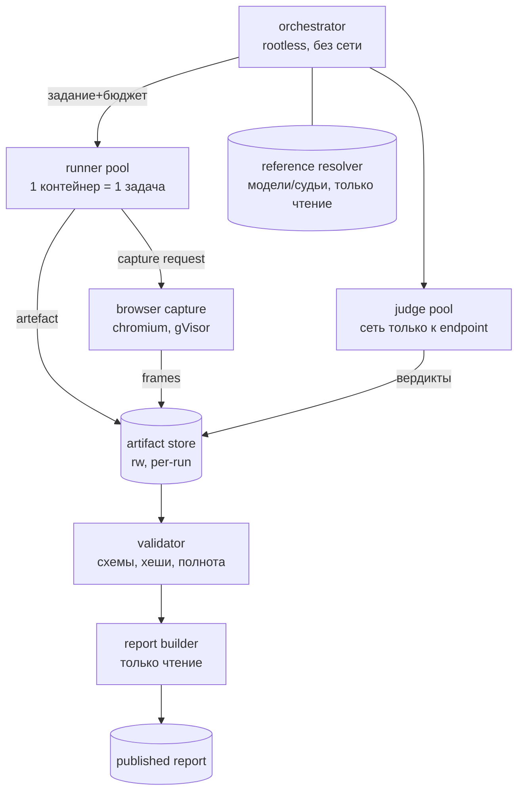

# Спецификация фреймворка LLMCrewBench v2

Статус: проект. Дата: 2026-10-21. Область: расширение действующего
`dailybench` (профили `baseline-20261020` / `pilot` / `stretch-v1` / `research-v1`) до
полного цикла «корпус → изолированное исполнение → доказательства →
интерпретируемый отчёт».

Документ опирается на действующие контракты репозитория:
[ARTIFACTS.md](ARTIFACTS.md), [visual-contract.md](visual-contract.md),
[art-contract.md](art-contract.md), [PROJECT_REVIEW.md](PROJECT_REVIEW.md).
Ничего из перечисленного ниже не отменяет эти контракты; разделы 4–6 их
расширяют.

## 1. Цели и границы

Цель — измерять модели так, чтобы **каждый балл имел доказательство**, а
**каждый вывод отчёта был проверяемым**. Три измеряемых качества:
детерминированное решение (математика, код, логика, многошаговый вывод),
визуально-творческая работа (генерация, мультимодальный разбор, эстетика),
и честность при неопределённости (языки, культуры, edge cases, отказ от
ответа).

Не цели: единый «рейтинг всего»; замена человеческой эстетической оценки
автоматической; требование фотореализма; гонка за объёмом промпта.

Базовые инварианты (уже действуют в коде и обязательны в v2):

1. **Фиксированный знаменатель.** `possible` задачи — свойство задачи, не
   ответа; штраф живёт внутри бюджета (`core.Score.max_points`).
2. **Тристейт допуска.** `True/False/None` (unverified ≠ pass).
3. **Слои доказательств.** Исходный ответ, display-производное и
   capture-производное хешируются и хранятся раздельно (ARTIFACTS.md).
4. **Вердикт принадлежит supervisor-процессу.** Кандидат не пишет
   доверенные файлы; отказ раннера — провал, а не «нет данных».
5. **Профили неизменяемы.** Новый смысл — новый профиль, старый не
   переписывается задним числом.
6. **Ошибка инфраструктуры ≠ ошибка модели.** Раздельные статусы
   `evaluator_unavailable`, `capture_failed`, `media_missing`, `not_run`.

Категории прогона A–L не переименовываются: направление задаёт новое поле
`block` (`deterministic`/`open`), `category` остаётся для совместимости
с историей и весами.

## 2. Принципы построения корпуса

- **Сложность из состояния, а не из объёма.** Причинная зависимость,
  конфликт версий, томбстоун, гонка, недоспецифицированный вход.
- **Независимый oracle.** Ожидание считается отдельной функцией/решателем,
  а не берётся из эталонной страницы.
- **Негативный мутант к каждому сценарию.** Правдоподобно неверный ответ,
  который обязан провалить целевой чек.
- **Слепой holdout.** Набор seed, не использованный при настройке; после
  публикации не перенастраивается.
- **Лингвистическая и культурная адаптация, а не перевод.** Формат дат,
  календари, единицы, валюты, порядок имён, письменность, RTL.
- **Бюджет ответа объявляется в задаче** и одинаков для всех моделей.

## 3. Источники и что из них берётся

Анализ, а не копирование. Колонка «берём» — конструктивный приём; колонка
«граница» — почему источник сам по себе не годится.

| Источник | Что доказывает | Берём | Граница |
|---|---|---|---|
| MMLU / MMLU-Pro [1][2] | широкое предметное знание, 10 вариантов | формат многовариантности, стратификация по предметам | статичный, насыщен, утечка в претрейн |
| LiveCodeBench [3] | код без утечки по датам релиза | привязка задач к окну времени, свежие срезы | требует живой ленты задач, версии языка |
| LiveBench [4] | контаминация-ограниченный срез | «живой» слой задач с датой публикации | зависимость от поставщика задач |
| HumanEval / SWE-bench | базовый код и правки в репозитории | hidden acceptance-тесты, репозиторные фикстуры | насыщены, узкая выборка |
| MMMU / MMMU-Pro [5] | мультимодальный разбор диаграмм/схем | визуальный вход + точный ответ | нужен image-вход, а не генерация |
| VQAv2 / TextVQA / ChartQA | чтение текста и графиков | подсчёт по регионам, OCR-метрики | короткие ответы, шаблонность |
| Global MMLU / MGSM / FLORES-200 / Belebele [6][7] | языковое покрытие, low-resource | трёхуровневая стратификация языков (high/mid/low), RTL/скрипты | перевод ≠ культурная адаптация |
| GenEval / BizGenEval | композиционное соответствие генерации | подсчёт объектов/атрибутов/отношений | требует image-выхода |
| AVA / LAION-Aesthetics [8][9] | эстетика как распределение оценок | человеческие оценки, поправка на склонность предиктора | предиктор ≠ вкус, культурный сдвиг |
| LiveBench/MMLU-CF [1][10] | приёмы де-контаминации | n-граммный фильтр, перефразирование, приватный test | перефразирование обходит фильтры [11] |

**Статус HuggingFace Open LLM Leaderboard:** публичный лидерборд закрыт и
архивирован (2024–2025), актуальные значения доступны только как архив
[15]; поэтому он полезен как источник исторической калибровки, но не как
живой рейтинг. Живые срезы берём у LiveCodeBench/LiveBench.

[15]: https://huggingface.co/collections/OpenEvals/archived-open-llm-leaderboard-2024-2025

[1]: https://github.com/TIGER-AI-Lab/MMLU-Pro
[2]: https://artificialanalysis.ai/evaluations/mmlu-pro
[3]: https://livecodebench.github.io/
[4]: https://www.semanticscholar.org/paper/LiveBench%3A-A-Challenging%2C-Contamination-Limited-LLM-White-Dooley/774d01e152003f342596031c0c0fbf1936dee41a
[5]: https://mmmu-benchmark.github.io/
[6]: https://cohere.com/research/globalmmlu
[7]: https://github.com/facebookresearch/flores/blob/main/flores200/README.md
[8]: https://www.researchgate.net/publication/261336804_AVA_A_large-scale_database_for_aesthetic_visual_analysis
[9]: https://laion.ai/blog/laion-aesthetics/
[10]: https://aclanthology.org/2025.acl-long.656.pdf
[11]: https://www.lmsys.org/blog/2023-11-14-llm-decontaminator/

### 3.1. Таксономия корпуса

Два направления равного веса, плюс сквозной слой честности.

**DET — детерминированные (единственный верный ответ).**

| Семейство | Пример | Oracle | Мутант |
|---|---|---|---|
| det/math | точное рациональное решение с ограничением домена | независимый символьный/дробный пересчёт | перепутанный знак, потерянное ограничение |
| det/logic | конечный автомат по событиям с tombstone | эталонный переход | применённое отозванное событие |
| det/code | правка функции под hidden acceptance | supervisor hidden tests | дописанная функция, частичный фикс |
| det/tools | транзакция с rollback и version check | детерминированный driver | deploy после FAIL |
| det/data | join shards по стабильному ID с provenance | независимая модель множества | join по имени, учёт удалённого |

**VIS — визуальные и креативные (без жёсткого эталона).**

| Семейство | Пример | Проверяемое | Оценка |
|---|---|---|---|
| vis/sim | численная сцена с фиксированным `dt` и шагами | probe + независимый replay + кадр | 4 равных чека |
| vis/vqa | диаграмма/карта с вопросом | точный ответ/регион | accuracy + калибровка |
| vis/gen | композиция по брифу (объекты, атрибуты, отношения) | детектор/сегментация | доля выполненных условий |
| vis/art | тема без рецепта | доставка, ошибки, кадр | 1 балл доставки + человеческое ревью |
| vis/aes | ранжирование пар по эстетике | согласие с экспертами | Krippendorff α, win-rate |

**CUL — сквозной слой культур/языков/edge cases.** Не отдельный балл, а
стратификация внутри DET и VIS: минимум 25 % сценариев каждого профиля
исполняются на не-английском (из них половина — mid/low-resource, RTL и
нелатинские скрипты), минимум 10 % — культурно-специфичны (календари,
единицы, форматы документов, имена), минимум 5 % — edge cases (пустой
вход, конфликтующие источники, обрезка, Unicode NFC/NFD). Брифы
адаптируются, а не переводятся: задачи-близнецы на разных языках имеют
отдельные ID и собственные фикстуры.

### 3.2. Контроль контаминации

- Приватный слой: 20 % задач каждого семейства никогда не публикуются в
  тексте; публикуются только хеши и агрегаты.
- n-граммный фильтр (13-граммы) публичного слоя против известных корпусов;
  перефразированный дубль ловится embedding-порогом + ручной проверкой.
- Задачи с датой: всё, что опубликовано после релиза модели, помечается
  `fresh_after`; отчёты показывают срез «только свежие».
- Каждый отчёт печатает дату среза и версию профиля; смешивание срезов в
  одной таблице запрещено.

## 4. Формат задачи

Единая YAML-схема, версионируемая (`schema: dailybench/task/2`).
Детерминированные и открытые задачи отличаются полем `kind` и блоком
`checks`; всё остальное (вход, бюджет, provenance) общее.

### 4.1. Детерминированная задача

```yaml
schema: dailybench/task/2
id: SCHED-7
block: deterministic
category: D
family: det/data
kind: deterministic
languages: [ru, kk]              # брифы-близнецы ссылаются на один oracle
cultures: [kz]
fresh_after: "2026-07-01"
budget:
  max_answer_tokens: 2048
  wall_clock_s: 600
prompt: |
  Ниже журнал смен и три версии политики. Построй расписание на дату среза
  2026-09-01, учитывая отзыв последней версии…
workspace:
  files: {shift.log: "…", policy-v1.yaml: "…", policy-v2.yaml: "…", policy-v3.yaml: "…"}
tools: [read_file, grep]
oracle:
  solver: dailybench.oracles.sched:v3   # независимая функция, не эталонный ответ
  seed: 4417
  expect:
    schedule: [...]
    revoked: [...]
checks:                                 # сумма points == budget.max_points
  - {name: exact_schedule, points: 2.0}
  - {name: revoked_ignored, points: 1.0}
negative_mutant:
  patch: dailybench.mutants.sched:ignore_revocation
holdout_seeds: [9901, 9902, 9903]
provenance:
  derived_from: "internal"
  license: CC-BY-4.0
  owners: [eval-team]
```

### 4.2. Открытая визуальная задача

```yaml
schema: dailybench/task/2
id: ART-41
block: open
category: L
family: vis/art
kind: open
languages: [ru]
budget:
  max_answer_tokens: 16384
  wall_clock_s: 900
prompt: |
  Создай одну самостоятельную визуальную работу на тему «рынок на рассвете».
  Композиция, палитра, статика или движение — на твой выбор.
deliverable:
  type: html
  require_standalone: true
capture:
  mode: realtime_capture        # либо static_capture, deterministic_steps
  viewport: {width: 1920, height: 1080, dpr: 1}
  settle_ms: 1200
  sample_ms: 400
checks:
  - {name: delivery, points: 1.0}
provenance:
  derived_from: "internal"
  license: CC-BY-4.0
```

### 4.3. Метаданные прогона

Манифест профиля (`dailybench/profile/2`): список ID, веса категорий,
резолвленные бюджеты, `schema/evaluator/harness/capture` fingerprints,
дата среза, holdout-набор. Прогон пишет commit-generation (см. 6.5) с
`run_id`, `generation`, хешами всех слоёв. Никакой отчёт не строится из
неполной generation.

## 5. Оценивание

**Детерминированные:** точные счётчики/ID/состояния — точное сравнение;
float — допуск, выведенный из округления probe (4 знака) и схемы;
отдельный контрпример на каждый допуск. `possible == max_points` всегда.

**Открытые:** доставка отдельно от вкуса. vis/gen — доля выполненных условий
брифа; vis/aes — парные сравнения, не абсолютная шкала.

**Judge-слой (только там, где нет oracle):**

- слепые пары, случайный порядок, обмен местами (position-bias контроль);
- калибровка на 200 размеченных человеком парах до допуска judge'а;
- публикуются Krippendorff α (цель ≥ 0.67) и доля ничьих;
- judge не может менять детерминированный балл.

**Статистика:** бутстрэп-ДИ (10 000 ресемплов) на каждую метрику; отчёт
без ДИ не публикуется. Разница моделей значима только при непересечении
95 % ДИ. Малые выборки (< 30) помечаются «ориентировочно».

**Честность:** `unverified` (нет измерения) не превращается в pass и не
сжимает знаменатель; `skipped` не входит ни в числитель, ни в знаменатель.

## 6. Архитектура исполнения (Docker)

### 6.1. Схема



### 6.2. Контейнеры

| Сервис | Образ | Сеть | Монтирования | Лимиты |
|---|---|---|---|---|
| orchestrator | `dailybench/orch@sha256` | нет | profiles ro, store rw | 1 CPU, 512 MiB |
| runner | `dailybench/runner-<lang>@sha256` | нет | task ro, store rw | 2 CPU, 2 GiB, 600 s |
| capture | `dailybench/capture@digest` | нет (local files) | page ro, store rw | 4 CPU, 4 GiB, 900 s |
| judge | `dailybench/judge@digest` | только endpoint | store ro | 1 CPU, 1 GiB |
| report | `dailybench/report@digest` | нет | store ro, out rw | 1 CPU, 512 MiB |

Образы только по digest; `latest` запрещён. Сборка reproducible: pinned
base, `SOURCE_DATE_EPOCH`, lock-файлы, SBOM (syft) и подпись (cosign) в
публикации.

### 6.3. Изоляция

- rootless Docker + **gVisor (`runsc`)** для runner/capture: Sentry
  перехватывает syscalls, host kernel не виден [12][13]. Для максимального
  риска (агентный код с сетью) — опция Firecracker microVM [14]; выбор
  фиксируется в манифесте прогона и печатается в отчёте.
- seccomp: `defaultAction: SCMP_ACT_ERRNO`, белый список ~120 вызовов;
  `no-new-privileges`, все capabilities сброшены, `read_only` rootfs,
  `tmpfs` только на `/tmp` (64 MiB), `pids_limit=256`.
- Сеть: runner — `--network none`; judge — egress только к резолвнутому
  endpoint; capture — none (локальный http-сервер внутри контейнера).
- Монтирования: задача `ro`, store — отдельный подкаталог generation (rw).
  Никаких bind-mount домашних каталогов.
- Агентные категории (C/K/L) исполняются в контейнере
  (`dailybench/isolation.py`), а не на хосте: монтируется только предъявляемая
  фикстура (rw, чтобы агент оставил ответ) и конфиг harness (`/agent`), без
  репозитория, `task.oracle` и соседних рабочих копий. Окружение — allowlist
  (`DAILYBENCH_API_KEY` в него не входит), путь наружу один:
  `host.docker.internal` до endpoint. Записывается фактически применённое:
  `container_run`/`host_run` + причина; падение на хост допустимо, но помечено.
  Образ обязан нести pinned `pi`, версия проверяется внутри контейнера.
- Кандидат не пишет доверенные файлы: вердикт пишет supervisor-процесс
  (child-runner + nonce/eof, см. `coding_python.py`).

### 6.4. Ресурсы

cgroups v2: `cpu.max`, `memory.max`, `memory.swap.max=0`, `io.max`.
Watchdog: absolute deadline задачи → SIGKILL дерева (Job Object на Windows).
OOM/таймаут даёт исход `resource_exhausted` (не `evaluator_failure`), не ноль
модели.

[12]: https://gvisor.dev/docs/architecture_guide/security/
[13]: https://www.sitepoint.com/isolate-untrusted-code-rootless-docker-gvisor/
[14]: https://fly.io/learn/firecracker-vs-gvisor/

### 6.5. Воспроизводимость

Generation-манифест: `run_id`, `generation`, профиль, хеши образов
(`image_digest`), seed, версии schema/evaluator/harness/capture, хеши
каждого файла. Читатель принимает только целую generation; подмена байта
ломает identity. `resume` сверяет полную identity, профиль и знаменатель.

Проверка «с нуля»: чистое дерево, без сети и старого cache → все внешние
ресурсы внутри образов; отсутствующий ресурс — ошибка публикации.

## 7. Отчёты: метрики → визуальные элементы

Правило: **каждая цифра в отчёте имеет визуальный носитель и ссылку на
доказательство**; каждый визуальный элемент — сценарий чтения за 5 секунд,
10 секунд и провал в детали. Никаких «красивых» графиков без данных.

### 7.1. Таблица соответствия

| Метрика | Визуальный элемент | Сценарий чтения | Детализация |
|---|---|---|---|
| Балл по категориям (10 осей) | радар компетенций, 2–4 модели | форма профиля; провалы осей | клик по оси → задачи |
| Провалы по семействам × задачи | heatmap ошибок (модели × семейства) | где горит | ячейка → чек-лист провалов |
| Знаменатель/покрытие | полоса полноты прогона + статусы | что не проверялось | причины по задачам |
| ДИ метрики | усы/полоса неопределённости на шкале | значима ли разница | выборка/ресемплы |
| Семантика провалов | карта кластеров (embedding, UMAP/t-SNE) | скопления однотипных ошибок | кластер → примеры + частоты |
| Визуальные ответы | visual diff: эталон/ответ/разностный регион | локальность расхождения | слайдер времени, probe |
| Доставка vs вкус (vis) | двухосевой scatter, квадранты | «работает, но некрасиво» | пара кейсов |
| Judge-надёжность | α-гейдж + полоса согласия | можно ли верить | пары, где судьи разошлись |
| Стоимость | точка «балл за токен/секунду» | цена единицы качества | прогон/задачи |

### 7.2. Композиция дашборда

Сверху вниз: (1) вердикт с ДИ и датой среза; (2) радар; (3) heatmap
ошибок; (4) полнота и статусы; (5) карта кластеров; (6) визуальные диффы.
Мокап:

```svg
<svg viewBox="0 0 960 540" role="img" aria-label="Мокап дашборда">
  <rect x="0" y="0" width="960" height="540" fill="none"/>
  <text x="24" y="34" font-size="18" fill="#e6edf3">Отчёт: профиль stretch-v1 · срез 2026-10-21 · ДИ 95%</text>
  <rect x="24" y="52" width="300" height="190" rx="8" fill="#11161d" stroke="#2b3440"/>
  <text x="40" y="76" font-size="13" fill="#9aa7b4">Радар компетенций</text>
  <polygon points="174,100 250,130 234,190 174,205 120,170 118,120" fill="#4cc2ff" fill-opacity="0.25" stroke="#4cc2ff"/>
  <polygon points="174,120 220,140 210,175 174,185 140,165 140,135" fill="#b48cff" fill-opacity="0.2" stroke="#b48cff"/>
  <rect x="340" y="52" width="380" height="190" rx="8" fill="#11161d" stroke="#2b3440"/>
  <text x="356" y="76" font-size="13" fill="#9aa7b4">Heatmap ошибок (модель × семейство)</text>
  <g>
    <rect x="360" y="92" width="44" height="18" fill="#3ddc97" fill-opacity="0.3"/>
    <rect x="408" y="92" width="44" height="18" fill="#f2c14e" fill-opacity="0.7"/>
    <rect x="456" y="92" width="44" height="18" fill="#ff6b6b" fill-opacity="0.85"/>
    <rect x="360" y="114" width="44" height="18" fill="#3ddc97" fill-opacity="0.3"/>
    <rect x="408" y="114" width="44" height="18" fill="#3ddc97" fill-opacity="0.3"/>
    <rect x="456" y="114" width="44" height="18" fill="#f2c14e" fill-opacity="0.6"/>
    <rect x="360" y="136" width="44" height="18" fill="#ff6b6b" fill-opacity="0.8"/>
    <rect x="408" y="136" width="44" height="18" fill="#f2c14e" fill-opacity="0.5"/>
    <rect x="456" y="136" width="44" height="18" fill="#3ddc97" fill-opacity="0.3"/>
  </g>
  <rect x="736" y="52" width="200" height="190" rx="8" fill="#11161d" stroke="#2b3440"/>
  <text x="752" y="76" font-size="13" fill="#9aa7b4">Полнота</text>
  <rect x="752" y="88" width="168" height="14" rx="7" fill="#2b3440"/>
  <rect x="752" y="88" width="128" height="14" rx="7" fill="#4cc2ff"/>
  <text x="752" y="126" font-size="12" fill="#e6edf3">проверено 76%</text>
  <text x="752" y="148" font-size="12" fill="#9aa7b4">не проверено 10%</text>
  <text x="752" y="170" font-size="12" fill="#9aa7b4">capture/missing 14%</text>
  <rect x="24" y="262" width="560" height="250" rx="8" fill="#11161d" stroke="#2b3440"/>
  <text x="40" y="286" font-size="13" fill="#9aa7b4">Семантические кластеры провалов</text>
  <g fill="#f4a3ff" fill-opacity="0.5">
    <circle cx="120" cy="360" r="9"/><circle cx="150" cy="372" r="6"/><circle cx="176" cy="352" r="7"/>
    <circle cx="360" cy="410" r="8"/><circle cx="386" cy="398" r="5"/><circle cx="400" cy="424" r="6"/>
    <circle cx="250" cy="470" r="5"/><circle cx="268" cy="452" r="4"/>
  </g>
  <circle cx="150" cy="370" r="48" fill="none" stroke="#2b3440" stroke-dasharray="3 3"/>
  <circle cx="385" cy="410" r="42" fill="none" stroke="#2b3440" stroke-dasharray="3 3"/>
  <rect x="604" y="262" width="332" height="250" rx="8" fill="#11161d" stroke="#2b3440"/>
  <text x="620" y="286" font-size="13" fill="#9aa7b4">Visual diff (эталон / ответ)</text>
  <rect x="620" y="298" width="140" height="90" fill="#2b3440" fill-opacity="0.6"/>
  <rect x="776" y="298" width="140" height="90" fill="#2b3440" fill-opacity="0.3"/>
  <rect x="820" y="326" width="52" height="36" fill="#ff6b6b" fill-opacity="0.35" stroke="#ff6b6b"/>
  <text x="620" y="424" font-size="12" fill="#e6edf3">расхождение: положение объекта</text>
  <text x="620" y="446" font-size="12" fill="#9aa7b4">шаг 45 · probe Δ = 0.0 по x</text>
</svg>
```

### 7.3. Правила интерпретируемости

- Все элементы — из одного summary-объекта; визуализация не пересчитывает
  метрики.
- Цвет — не единственный носитель: статусы подписаны, heatmap дублируется
  числом в ячейке при hover/focus.
- Палитра — `--c1…--c6` + `success/warning/error`, проверена на
  дальтонизм; контраст ≥ 4.5:1.
- Провал с причиной: `not_run` ≠ `model_failed` ≠ `capture_failed` —
  разный цвет и иконка.
- Каждый элемент имеет URL на доказательство (страница, кадр, транскрипт);
  отчёт открывается без сети.
- Краткая полоса «5 секунд»: 3 главных вывода и 3 главных риска
  генерируются из чисел, а не вручную.

## 8. Этапы и приёмка

1. **Контракт и схемы.** `schema/task/2`, `profile/2`, валидатор + CI;
   миграция текущих A–L без изменения смысла.
2. **Изоляция.** rootless + gVisor, лимиты, watchdog; верификация:
   бесконечный цикл, fork-бомба, запись вне mount, чтение env, сеть.
3. **Пилот корпуса.** 30 det + 20 vis + 10 cul-страт; эталон/мусор/мутант,
   приватный слой, бутстрэп-отчёт.
4. **Judge-слой.** калибровка, α ≥ 0.67, отчёт о согласии.
5. **Визуальный отчёт.** компоненты 7.1–7.2, доступность, drill-down.
6. **Публичный релиз.** артефакты, SBOM, хеши, отчёт без сети; повторный
   прогон «с нуля» совпадает по хешам на закреплённом профиле.

Критерий успеха пилота: каналы не смешиваются (доставка, probe,
независимый oracle, кадр), у каждой цифры есть ДИ и доказательство,
ни один edge case не провален всеми моделями только из-за формулировки.

## 9. Риски

| Риск | Митигация |
|---|---|
| Насыщение и утечка | приватный слой, даты, ротация тем |
| Judge смещает балл | слепые пары, α-гейт, детерминированный балл независим |
| Дорогой рендер/капчур | кэш с полным fingerprint, статусы инфраструктуры |
| GPU/среда меняет пиксели | профиль рендера в доказательствах, допуски, не байтовое равенство |
| Схема задачи станет «книгой рецептов» | лимит брифа, сложность из состояния |
