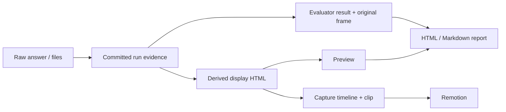

# Ревью LLMCrewBench

Дата фиксации: 2026-10-20. Объект: рабочая копия проекта на момент аудита.

## Статус и границы

Это отчёт об исследовании, не перечень уже внесённых исправлений. В рамках ревью исходники, оценщики и опубликованные результаты не исправлялись. Безопасные воспроизведения выполнялись в системных временных каталогах, на loopback HTTP-серверах и на локальных страницах. Реальная модель/GPU и полный экспорт ролика не запускались.

Обозначения:

- **P1** — исправить до следующих доверенных публикаций или длительных прогонов.
- **P2** — исправить следующим системным проходом.
- **Воспроизведено** — наблюдалось в выполненном smoke или в браузере.
- **Статически подтверждено** — путь прослежен по исходникам, но соответствующий runtime не запускался.
- **[INFERENCE]** — следствие или риск; не выдаётся за наблюдавшийся инцидент.

Ниже сохранены выводы предыдущего полного ревью. Углублённый разбор заданий и план их развития вынесены в [A–J](TASKS_AJ_REVIEW.md) и [K/L](TASKS_KL_ROADMAP.md).

## Выполненная проверка

Это результаты выполненного запуска аудита, а не обещание состояния после будущих изменений.

| Проверка | Наблюдавшийся результат |
| --- | --- |
| `python -m pytest tests --tb=short` | 362 passed, 11 failed, 253.25 s |
| `python -m dailybench selfcheck --only A,B,C,D,E,F,G,H,I,J` | Все 47 заданий: эталон получает полный балл, мусор — ноль |
| `npm run typecheck` в `video/` (репозиторий LLMCrewBenchRecoder) | Exit code 0 |
| Генерация при `PYTHONHASHSEED=1` и `2` | Хеши сьюта совпали |
| Опубликованный HTML-отчёт | Основная страница открывается; графики и живая K-1 не работают без `_vendor` |
| Remotion `scene-showcase`, кадр 300 | Ошибка загрузки отсутствующего MP4 |
| Сборка wheel | В архиве нет `three.module.js` и `plotly.min.js` |
| Направленные smoke | Проверены grader spoofing, rollback, resume, дедлайны, admission, импорт отчётов, ограничения правки J-1 и учёт токенов |

Девять падений pytest относятся к POSIX-зависимостям agent-тестов на Windows; ещё два — разделители путей в allowlist и shell-подмена `nvidia-smi`. Не следует трактовать это как 11 независимых дефектов оценивания. Прохождение selfcheck не доказывает стойкость оценщика к специально подготовленному ответу.

## 1. Оценивание и достоверность

### R01. P1 — C-1 получает 8/8 без реализации кеша

**Код:** [coding_python.py:499–550](../dailybench/tasks/coding_python.py#L499), [evaluate:555–580](../dailybench/tasks/coding_python.py#L555).

Оценщик принимает путь к JSONL-результатам из строки `REPORT …` в stdout процесса, исполняющего код кандидата. Кандидат может сам создать файл, вывести маркер и завершиться до hidden tests.

**Воспроизведено:** код без класса `AsyncTTLCache` получил 8/8. В notes одновременно указано, что публичный класс/метод не найден. Воспроизведение писало только внутри собственного временного sandbox.

Это не доказательство подделки опубликованного прогона; это доказательство отсутствия надёжной границы доверия в grader.

**Решение:** stdout кандидата — журнал, а не канал вердикта. Утверждения и итоговый результат должны принадлежать доверенному supervisor, отделённому от изменяемого кандидатом исполнения. Проверка отсутствующего класса сама по себе не решает проблему аутентичности результата.

### R02. P1 — неизвестный long-context admission считается подтверждённым

**Код:** [longctx.py:432–434](../dailybench/tasks/longctx.py#L432), [report.py:80–110](../dailybench/report.py#L80), [headline:132–144](../dailybench/report.py#L132).

Evaluator выдаёт `admission=None`, если runtime не сообщил `prompt_tokens`. Summary отклоняет только явный `False`.

**Воспроизведено:** LC-1 с правильным ответом без usage имеет `admission=None`, примечание о неподтверждённом размере входа, но summary сообщает `long_context_admitted=True` и `2/2`.

**Решение:** сохранить `passed / failed / unverified` до headline; неизвестное состояние не включать в подтверждённый E. Не превращать отсутствие измерения в ошибку модели.

### R03. P1 — знаменатель T-4 зависит от ответа модели

**Код:** [tools.py:1040–1052](../dailybench/tasks/tools.py#L1040), [закрепляющий поведение тест](../tests/test_harness.py#L294).

При запрещённом действии добавляется новый проваленный check стоимостью один балл.

**Воспроизведено:** `task.max_points=2`, но `score.possible=3`. Масштаб всего бенчмарка становится зависимым от ответа.

**Решение:** штраф внутри фиксированного бюджета задания; `possible == max_points` при любом ответе, а не только у эталона. Существующий тест на знаменатель 3 заменить проверкой потребительского инварианта, а не перепривязать к новому случайному числу.

### R04. P2 — rescore превращает «не проверялось» в ноль

**Код:** [rescore.py:38–69](../dailybench/rescore.py#L38), [запись:75–97](../dailybench/rescore.py#L75).

Пересчёт непосредственно вызывает evaluator, не сохраняя исходный `skipped` и политику unsupported. `changed` сравнивает earned/admission, но не possible/status.

**Воспроизведено:** пропущенный IF-1 с `possible=0` стал `0/2`, `skipped=None`; `rescored.json.changed` остался пустым. Задания пересчёта также сопоставляются по ID без проверки fingerprint исходной фикстуры.

**Решение:** сохранять применимость, проверять fingerprint задания, регистрировать все изменения состояния. Пересчёт должен быть атомарным и не смешивать старые/новые scores при прерывании.

### R05. P2 — J-1 допускает добавление функции вместо однострочной правки

**Код:** [review.py:718–725](../dailybench/tasks/review.py#L718).

`zip` сравнивает только общий префикс. Если прежний файл не изменён, `changed=[]`; разная длина не проверяется.

**Воспроизведено:** к неизменённому дефектному файлу дописана исправленная функция, ещё 11 строк. Получено 3/3, включая прохождение всех семи hidden tests.

**Решение:** независимо проверить длину/допустимую форму diff, затем место изменения. Не оценивать количество строк как качество исправления в новых задачах, если однострочность не является содержательной частью брифа.

### R06. P2 — матрица отчёта объединяет разные прогоны одной модели

**Код:** [htmlreport.py:308–316](../dailybench/htmlreport.py#L308), [выбор ячейки:329–334](../dailybench/htmlreport.py#L329).

Ключ — отображаемое имя модели, а не run ID.

**Воспроизведено:** два прогона с одинаковым `config.model`, но результатами `2/2` и `0/2`, отображаются двумя полностью успешными ячейками.

**Решение:** индексировать по неизменяемому run ID; label/model использовать только как текст подписи. Проверять обычное сравнение двух квантов и повторов одной модели.

## 2. Выполнение, восстановление и данные

### R07. P1 — rollback coder_loop удаляет .git

**Код:** [snapshot/restore:177–209](../scripts/coder_loop.py#L177), [вызовы:280](../scripts/coder_loop.py#L280), [304](../scripts/coder_loop.py#L304).

Snapshot исключает `.git`; restore удаляет файлы, отсутствующие в snapshot, не исключая Git-метаданные.

**Воспроизведено:** откат без изменений удалил `.git/HEAD` в тестовом временном проекте.

**Решение:** единый набор исключений для snapshot/restore; исключённые служебные каталоги не участвуют в удалении. До исправления не применять этот rollback к рабочему репозиторию.

### R08. P1 — API-ключ сохраняется в артефакт

**Код:** [config.py:185–188](../dailybench/config.py#L185), [runner.py:540](../dailybench/runner.py#L540), [тест:102–105](../tests/test_local_config.py#L102).

`asdict(self)` сериализует `api_key`; runner записывает его в `config.json`. Каталог опубликованного прогона допускается к публикации правилами Git.

**Воспроизведено:** canary-ключ записан без изменений. В просмотренном опубликованном конфиге значение `not-needed`; утечка настоящего ключа не установлена.

**Решение:** секреты исключить из persistence и публикации. Сохранять способ получения credentials, но не значение. Тест, требующий сериализации секрета, закрепляет дефект.

### R09. P1 — resume воскрешает результаты предыдущего запуска

**Код:** [runner.py:547–550](../dailybench/runner.py#L547), [cli.py:698–722](../dailybench/cli.py#L698), [identity:650–651](../dailybench/cli.py#L650), [early return:635–636](../dailybench/cli.py#L635).

Перезапись master не удаляет старые per-task mirrors. Они подмешиваются даже к исправному актуальному `tasks.json`.

**Воспроизведено:** после сохранения C-1/C-2 и повторной записи только C-1 resume вернул также старый C-2. Отдельно смена `agent=True` на `False` не отклоняется; при отсутствии master валидные зеркала игнорируются.

**Решение:** идентичность запуска в каждом checkpoint, fingerprint полного harness/budget contract, явный отказ от повторного использования чужого каталога. Mirrors восстанавливают только тот же run, а не дополняют любой текущий master.

### R10. P1 — дедлайны не являются абсолютными

**Код:** [providers.py:140–148](../dailybench/providers.py#L140), [stream:187–190](../dailybench/providers.py#L187), [browser hooks:605–623](../dailybench/browser.py#L605).

Stream проверяет время после получения строки; blocking ограничивает socket operation, не весь запрос. Browser hooks выполняются вне общего deadline.

**Воспроизведено:** при `wall_clock=0.05` streaming завершился ошибкой через примерно 0.344 s, blocking успешно прочёл побайтовый JSON за примерно 0.672 s. Browser hook с задержкой 800 ms пережил `timeout_ms=100`.

**[INFERENCE]:** бесконечный hook может удерживать evaluator без установленного здесь внешнего watchdog.

**Решение:** абсолютный deadline на подключение/чтение/исполнение, принудительное завершение зависшего worker. Timeout отдельной навигации не называть общим лимитом.

### R11. P1 — после tool budget запросы могут продолжаться бесконечно

**Код:** [runner.py:271–289](../dailybench/runner.py#L271), [поздняя проверка:344–348](../dailybench/runner.py#L344).

`continue` при `room <= 0` обходит проверку накопленных tokens. Endpoint может продолжать возвращать tool calls без переданных tools.

**Воспроизведено:** при total budget 2 получен 401 token; один инструмент исполнен, дальнейшие запросы остановлены только ограничивающей smoke ошибкой.

**Решение:** единые stop conditions до любого продолжения цикла и до очередного запроса.

### R12. P1 в текущей среде — cleanup агента не работает на Windows

**Код:** [agent.py:397–423](../dailybench/agent.py#L397), [cwd discovery:435–448](../dailybench/agent.py#L435).

Безусловные `os.getpgid`, `os.killpg`, POSIX signals и внешние `ps/lsof` не образуют Windows lifecycle.

**Воспроизведено:** `_kill_tree()` выбросил `AttributeError` на `os.getpgid`; собственный harmless child оставался жив до отдельного cleanup. Падения POSIX shell-тестов на Windows отдельно перечислены в результатах проверки.

**Решение:** платформенный lifecycle, Windows Job Objects либо явно поддерживаемая среда запуска; переносимые fake executables в тестах. На POSIX отдельно проверить descendants, которые переживают root, игнорируют TERM или меняют cwd.

### R13. P1 — sweep падает после preflight

**Код:** [sweep.py:70–72](../scripts/sweep.py#L70).

`time.time()` используется без импорта `time`.

**Воспроизведено:** после безопасно подменённого успешного preflight возникает `NameError`. Ruff выдаёт F821.

**Решение:** импорт и smoke оркестрации целиком без живой модели, а не только отдельных subcommands.

### R14. P2 — протокольные/инфраструктурные ошибки маскируются под ответ

**Код:** [providers.py:203–246](../dailybench/providers.py#L203), [cli.py:335–337](../dailybench/cli.py#L335).

**Воспроизведено:** EOF без finish marker принят без error; SSE `error` проигнорирован и стал пустым успешным reply; CLI вернул 0 при HTTP 500 на всех chat-запросах.

**Решение:** валидировать terminal state протокола, сохранять infrastructure error отдельно от неверного ответа модели, ненулевой exit code при ошибке выполнения.

### R15. P2 — timeout теряет уже измеренные расходы агента

**Код:** [agent.py:598–614](../dailybench/agent.py#L598), [as_extra:185–194](../dailybench/agent.py#L185), [runner.py:408–425](../dailybench/runner.py#L408).

Timeout разбирает events, но не нормализует usage/tools/text. В persisted transcript raw events заменены их количеством.

**Проверено на смоделированной timeout-ветке:** в событиях есть завершённый assistant usage и tool call; нормализованные tokens `None`, turns 0, tool log пуст.

**Решение:** одна нормализация для успеха, ошибки и timeout; сохранять диагностически достаточные события и не представлять неизвестный расход нулевым.

## 3. Безопасность и доставка отчёта

### R16. P1 при импорте стороннего run — HTML/JS injection

**Код:** [htmlreport.py:593](../dailybench/htmlreport.py#L593), [692](../dailybench/htmlreport.py#L692), [784](../dailybench/htmlreport.py#L784), [868–871](../dailybench/htmlreport.py#L868).

Metadata попадают в heading без escaping, в script через обычный `json.dumps`, в viewer через `innerHTML`.

**Безвредно подтверждено:** `<b>` становится элементом heading; `</script>` остаётся буквальной последовательностью в блоке `const DATA`.

**[INFERENCE]:** контролируемые metadata импортированного run позволяют JS в origin отчёта. Это не утверждение, что обычный текст ответа модели управляет config.model.

**Решение:** контекстное escaping, безопасная сериализация JSON для HTML, DOM API вместо пользовательских значений в `innerHTML`.

### R17. P1 при импорте стороннего run — path traversal и local file inclusion в публикацию

**Код:** [gallery.py:435–437](../dailybench/gallery.py#L435), [485–496](../dailybench/gallery.py#L485).

`task.id` формирует путь без containment-проверки, `visual.shot` может быть произвольным существующим файлом.

**Воспроизведено:** ID `../review-escape` записал файл вне `frames`; локальный canary скопирован в публикацию. Всё происходило внутри собственного temporary tree.

**Решение:** схема и допустимые ID, artifact-root для источников, проверка разрешённого пути перед записью/копированием.

Отдельно: sandbox viewer не распространяется на `window.open` сырой сцены. **[INFERENCE]:** такая страница получает origin публикации; `noopener` отрезает opener, но не storage/сеть. Требуется отдельный origin или sandboxed host. Разрешённый локальному агенту `bash` сам по себе не классифицируется как remote escape.

### R18. P2 — публикация не самодостаточна; wheel не содержит visual assets

**Код:** [.gitignore:112](../.gitignore#L112), [опубликованный script:176](../reports/comparison-deepseek-1017/index.html#L176), [pyproject.toml:21–22](../pyproject.toml#L21), [browser.py:47–48](../dailybench/browser.py#L47).

**В браузере подтверждено:** missing `_vendor/plotly.min.js` → `Plotly is not defined`; missing `three.global.js` → ошибка `WebGLRenderer` и пустая K-1. В собранном wheel отсутствуют Three.js/Plotly assets.

**Решение:** публикация проверяется на замкнутость локальных ссылок; package data содержит ресурсы; smoke из изолированной установки, не только editable checkout.

## 4. Remotion и recording

### R19. P1 — Studio открывается, но необходимые медиа отсутствуют

**Код:** [Showcase.tsx:112–167](../../LLMCrewBenchRecoder/src/scenes/Showcase.tsx#L112), [showcase L-1:434–437](../../LLMCrewBenchRecoder/src/data/showcase.json#L434), [clips L-1:208–210](../../LLMCrewBenchRecoder/public/clips.json#L208).

**Воспроизведено:** отсутствуют все 70 MP4, объявленных доступными; на кадре 300 `scene-showcase` получены `MediaPlaybackError`, `MEDIA_ELEMENT_ERROR: Format error`, `readyState=0`. На кадре 0 видео ещё не смонтировано, поэтому открытие Studio ничего не доказывает о клипах.

Два манифеста расходятся для 1017/L-1: `clips.json=missing`, `showcase.json.missing=false`.

Архив медиа является документированной внешней зависимостью; его отсутствие не доказывает повреждение архива.

**Решение:** проверка файлов и манифеста до preview/render, понятная ошибка доставки медиа, единый источник статуса. Не маскировать это плашкой о провале модели.

### R20. P1 — ролик неверно интерпретирует покрытие и L

**Код:** [Showcase.tsx:125–127](../../LLMCrewBenchRecoder/src/scenes/Showcase.tsx#L125), [Final.tsx:103](../../LLMCrewBenchRecoder/src/scenes/Final.tsx#L103), [Theory.tsx:158–179](../../LLMCrewBenchRecoder/src/scenes/Theory.tsx#L158).

У прогона 1017 нет L-2…L-29, но показана плашка «модель не справилась». Новый L `1/1` — доставка HTML, а не художественный процент, однако он сравнивается с legacy `134/145`. Полные прогоны имеют разные размеры/fingerprints при заявленной побайтовой идентичности заданий.

Это не опровергает совпадение отдельных общих A–J задач; идентичность полных прогонов доступными артефактами не подтверждается.

**Решение:** различать `not_run / failed / unavailable_media`; сравнивать совместимые измерения; L — статус/покрытие/смотрим глазами, не процент вкуса.

### R21. P2 — видео повторно учитывает reasoning в токенах ответа

**Код:** [build_runs_data.py:43–49](../../LLMCrewBenchRecoder/tools/build_runs_data.py#L43), [канонический spend](../dailybench/core.py#L285).

**Воспроизведено:** completion 100, reasoning 60 → основной код показывает answer 40/reasoning 60, генератор видео — answer 100/reasoning 60.

**Решение:** использовать единый `Transcript.spend()`, а не второй алгоритм. Не выдавать неизвестные агрегаты за нулевые при отсутствии tasks/transcripts.

### R22. P2 — recording расходится с платформой и контрактом L

**Код:** [record_clip.py:44–54](../../LLMCrewBenchRecoder/tools/record_clip.py#L44), [350–364](../../LLMCrewBenchRecoder/tools/record_clip.py#L350), [probe_pages.py:50–58](../../LLMCrewBenchRecoder/tools/probe_pages.py#L50), [79–84](../../LLMCrewBenchRecoder/tools/probe_pages.py#L79), [record_all.py:112–116](../../LLMCrewBenchRecoder/tools/record_all.py#L112).

**Статически подтверждено:** macOS-пути Chrome/ffmpeg без PATH fallback, `rm` и `/tmp`; probe требует `__ready`, не обязательный для L; batch возвращает success при FAIL; missing clip не отличён от failed model; аргументы прямого recorder CLI входят в destructive paths без containment.

**[INFERENCE]:** пересъёмка не проходит штатным путём на заявленных альтернативных платформах; исправная свободная L-страница может быть забракована. Опасное удаление через recorder не запускалось.

**Решение:** один поддерживаемый recording pipeline, переносимые executables/temp/cleanup, readiness по capture mode, статусы infrastructure/model раздельно. В `docs/recording/` уже есть переиспользуемые механизмы, но их ограничения также требуется проверить; механически считать их полностью переносимой заменой нельзя.

## 5. Порядок устранения

1. **Границы доверия и сохранность:** R01, R07, R08, R09, R16, R17. Критерий: неправильно реализованный кандидат не подделывает успех; rollback не удаляет служебные данные; секретов нет в артефакте; run identity не смешивается.
2. **Инварианты результата:** R02–R06, R14–R15. Критерий: фиксированные знаменатели, явная неизвестность, совместимость rescore и независимые колонки сравнения.
3. **Ограниченное исполнение:** R10–R13. Критерий: bounded completion при stalled I/O/hook/tool loop; cleanup на поддерживаемых ОС; whole-sweep smoke.
4. **Самодостаточная публикация:** R18; восстановление реальных входных артефактов. Критерий: все локальные ссылки доступны после переноса каталога, без скрытого обращения к старому runs/cache.
5. **Честное видео:** R19–R22. Критерий: подтверждённые media manifests, статусы отсутствия не обвиняют модель, единая семантика L/spend, запись не выдается за исходный оценённый кадр.
6. **Усложнение заданий:** только после gates выше; подробности в отдельных планах A–J и K/L. Новая версия/профиль, не тихая замена значений старых ID.

## 6. Принципы дальнейшего развития

- Один нормализованный контракт результатов для CLI, HTML и видео: run ID, версии schema/suite/evaluator/harness, status, earned/possible/spend, происхождение медиа.
- Сохранённый прогон 1017 имеет 68 заданий; текущая генерация его конфигурации дала 96, различие — дополнительные L. Сырых tasks/transcripts в публикации нет. Поэтому независимый пересчёт исходного результата из checkout невозможен; старый результат этим не объявляется неверным.
- Проверять не только perfect/garbage, но и правдоподобные неправильные решения: boundary, mutation, transition, precedence, errors и попытки подмены канала результата.
- CI: поддерживаемые ОС, установка wheel, локальные ссылки отчёта, media preflight, end-to-end sweep без модели. Не заменять недоступность браузера/компилятора нулём модели.
- `RunResult.save()` переписывает все transcripts на каждом checkpoint: после исправления идентичности и восстановления перейти к записи только изменившегося task-record и к компактному согласованному индексу.
- Осмысленная сложность — новые причинные зависимости, состояния, интеграция и ошибки; не размер промпта, число шаблонов или стоимость рендера сами по себе.

## 7. Дополнительное подтверждение preview Three.js

Проверка выполнена на реальных страницах в отдельном Chromium с локальными библиотеками. Файлы отчётов не исправлялись: зависимости восстанавливались только в temporary copy. Это различает дефект решения, дефект доставки библиотеки и дефект преобразования preview.

### 7.1. Что действительно работает

Для эталонной K-1 использованы два пути:

1. Исходный `golden_html` с ES-import `./vendor/three.module.js`.
2. Тот же HTML через реальные `answer_html` → `scene_page` → `standalone_html`, локальный `three.global.js` и `STEP_HOOK`; автоплей в проверке отключён через состояние драйвера.

После 75 шагов по `1/60` получено:

| Наблюдение | Raw ES module | Standalone preview |
| --- | --- | --- |
| Готовность | `true` | `true` |
| Время симуляции | 1.25 s | 1.25 s |
| Состояние `__probe` | Побайтно одинаковый JSON | Побайтно одинаковый JSON |
| Буфер canvas | 800×600 | 800×600 |
| CSS-размер canvas при наблюдавшемся viewport 978×596 | 800×600 | 407.484375×305.625 |
| Ошибки JS, собранные до загрузки | Нет | Нет |

SHA-256 PNG из буфера canvas в обоих случаях:

```text
d260c07637e7f3c1a44d57b4db9643c151b0ffd9b73750d82c3e52c5c10b28f4
```

Ревизия standalone-библиотеки — Three.js 186, контекст — WebGL 2.0 Chromium. Сняты и просмотрены изображения canvas.

**Граница вывода:** совпадение подтверждено для K-1, одного browser/renderer profile и одного состояния. Это не доказательство совместимости всех K, разных GPU, Chromium-версий или всех форм JavaScript imports.

Сохранённая модельная K-1 из опубликованного отчёта также загрузилась в temporary copy после одного восстановления `_vendor/three.global.js`: `__ready=true`, Three.js 186, осмысленный probe после 75 шагов, изображение без JS errors. Код самой модели не менялся.

**Утверждённая причина текущей пустой K-1:** отсутствие библиотеки при публикации (R18), а не установленный дефект Three.js/WebGL или модели.

### 7.2. Preview — производный артефакт, не исходный кадр

[gallery.py:302–369](../dailybench/gallery.py#L302) добавляет stepping/autoplay, заменяет imports, вставляет подпись и меняет CSS layout/zoom. Измеренная разница CSS-размеров выше следует из расчёта масштаба относительно 1920×1080, а не относительно собственного canvas 800×600.

В проверке raw HTML имел 3598 bytes, производный — 13954 bytes; их SHA-256 различались. При одинаковом состоянии буфер canvas совпал, но screenshot viewport/кадр с подписями и масштабированием уже не равен исходному снимку evaluator.

**Решение:** хранить отдельно original HTML, original scored frame, display HTML, display frame и video clip. Называть каждый слой явно; производный preview не заменяет доказательство того, что оценивалось.

### R23. P2 — `seek(0)` выполняет один шаг

**Код:** [gallery.py:125–130](../dailybench/gallery.py#L125).

**Воспроизведено на свежем состоянии драйвера:** `__probe().steps=0`; после `__dbscene.seek(0)` возвращено 1, `steps=1`, `t=0.0167`. Причина — безусловный первый `beat()` при `shown===0`.

Это сдвигает первый запрашиваемый нулевой кадр и противоречит буквальному контракту «начало окна». Исторический клип этим не объявляется испорченным: фактическое влияние зависит от base/режима записи.

**Решение:** определить семантику нулевого кадра; render/probe без advance отделить от шага. Gate: на новом документе `seek(0)` не меняет физическое время, `seek(n)` воспроизводит n шагов, повторное `seek(n)` не продвигает время.

### R24. P1 — пересборка опубликованного отчёта удаляет существующие страницы и кадры

**Код:** [htmlreport.py:558–567](../dailybench/htmlreport.py#L558), [gallery.py:479–504](../dailybench/gallery.py#L479), [prune:508–512](../dailybench/gallery.py#L508).

В опубликованном run отсутствует `tasks.json`. `load_run` допускает его отсутствие, `showcase_entries` возвращает пустой список, затем materialise считает старые файлы лишними и вызывает prune.

**Воспроизведено end-to-end:** во временную копию опубликованного run перенесены реальные config/scores/suite и одна существующая K-1 со снимком. `write_report_html()` успешно записал новый отчёт, сохранил 68 scores, но число страниц/кадров изменилось с 1/1 на 0/0.

**Решение:** отсутствие сырого источника не является пустым результатом. До каких-либо удалений проверять полноту входа и совместимость manifest; при неполном входе отказ без мутаций либо отдельный explicitly read-only режим из опубликованного manifest. Сборка во временное дерево, затем согласованная замена. Не предлагать пользователю запускать rebuild над единственной копией публикации до исправления.

### R25. P2 — per-file atomicity не делает checkpoint транзакцией

**Код:** [runner.py:533–550](../dailybench/runner.py#L533), [rescore.py:82–97](../dailybench/rescore.py#L82).

`os.replace` защищает отдельный файл. Последовательность config → suite → scores → tasks → mirrors не является одной атомарной операцией. `rescore` дополнительно пишет файлы непосредственно.

**Воспроизведено:** в temporary run старый IF-1 имел 2/2; при сохранении нового 0/2 инъекция `OSError` перед заменой `tasks.json` оставила `scores.earned=0`, `tasks.earned=2`, mirror `earned=2`. Файлы по отдельности валидны.

**Решение:** immutable task records + commit manifest с generation/run ID и hashes. Читатель выбирает только полностью закоммиченное поколение; derived scores/report строятся из него. Для требований к power-loss отдельно нужны fsync/directory durability и её платформенная проверка; текущий `os.replace` такого доказательства не даёт.

### R26. P2 — cache key не включает полную среду рендера

**Код:** [visual.py:427–438](../dailybench/visual.py#L427), [art.py:28–30](../dailybench/art.py#L28), [browser flags](../dailybench/browser.py#L65).

В K ключ включает manual frame version, viewport, steps/dt и HTML; в L — manual version, mode, viewport, HTML. В нём нет hash Three.js, browser version, renderer/GPU, driver/extractor fingerprint и полного capture profile.

**Проверено:** замена VENDOR/launch args в bounded smoke не меняет K cache key; изменение viewport меняет его. Это проверка зависимости ключа, не эксперимент с разными GPU.

**Решение:** dependency/render fingerprint для пригодности cache; stored frame хранить и хешировать независимо от возможности повторного рендера. Различать reuse evidence и новое измерение. Manual version остаётся полезной, но не подменяет происхождение библиотек.

### R27. P2 — standalone-конвертер ломает допустимые named imports

**Код:** [gallery.py:221–243](../dailybench/gallery.py#L221).

Два безопасных fixture проверены в реальном браузере; локальная библиотека присутствовала:

| Форма imports | Raw HTTP с локальным vendor | После standalone-преобразования |
| --- | --- | --- |
| Только `import {…} from './vendor/three.module.js'` | Страница рисует куб, `ready=true`, alias Vector3 даёт `[1,2,3]` | Early return не преобразует import; запрос `pages/vendor/three.module.js` → 404, `ready=false` |
| Wildcard плюс `import {Vector3 as V3} …` | `new V3(1,2,3)` работает | Преобразовано в `const {V3}=window.THREE`, возникает `V3 is not a constructor` |

Таким образом, не всякая неисправность preview объясняется отсутствующим общим bundle. Есть отдельный дефект преобразования синтаксиса. Особенно важен для L, где контракт не обязывает выбирать wildcard import.

**Решение:** предпочтительно HTTP-serving неизменённого ESM artifact с корректной локальной раскладкой vendor; если standalone/file-export нужен, отдельный проверяемый syntax-aware converter. Не расширять цепочку regex частными заменами. Gate: wildcard, named, named aliases, их сочетание и importmap имеют одинаковое наблюдаемое поведение до/после экспорта; неподдерживаемая форма получает явный отказ экспорта, не молча сломанный HTML.

## 8. Что считать воспроизводимостью и записью отчёта

### 8.1. Четыре разных гарантии

1. **Fixture reproducibility:** одинаковы prompt/dialogue/workspace/tools и task protocol. Генерация по seed — лишь часть этой гарантии.
2. **Evaluation reproducibility:** тот же исходный artifact проверяется тем же evaluator/trace/profile. Численные результаты K воспроизводятся по объявленным схемам и допускам; bitwise PNG применим только внутри подтверждённого frozen rendering profile.
3. **Evidence preservation:** исходные ответы, raw events, оригинальный screenshot и журнал ошибок сохранены независимо от внешнего cache. Для L это основная гарантия: сохранение конкретного результата, а не требование детерминизма творчества.
4. **Presentation/capture reproducibility:** известны transforms, timing, driver и encoding, по которым построены preview и clip. Их нельзя незаметно принять за original scored frame.



L не получает обязательных `__step`, `__probe`, seed или анимации ради удобства recorder. Статичная работа допустима. Для свободной realtime-работы запись должна честно обозначаться realtime capture, с сохранённым источником и параметрами, без обещания побитового воспроизведения.

### 8.2. Минимальный контракт доказательств — предложение, не существующий формат

| Слой | Что сохранять/хешировать | Инвариант при чтении |
| --- | --- | --- |
| Run | run ID, generation ID, schema/suite/task/evaluator/harness fingerprints; resolved budgets | Никаких merges между разными identity/generation |
| Answer | исходный HTML и остальные файлы, исходные ответы/events, stdout/stderr с обозначенной политикой хранения | Исходные bytes не заменяются display/recording-патчами |
| Evaluation | status, earned/possible, admission, checkpoints/input trace, original frame SHA, ошибки | `unknown` не становится `passed`, denominator фиксирован |
| Render profile | Three.js hashes, Chromium build, renderer/GL backend, launch flags, viewport/DPR, fonts/color profile, extractor version | Cache reuse только при совместимом profile; профиль записан в evidence |
| Preview | source HTML SHA, display HTML SHA, transform/driver hashes, framing, локальные assets | Трассируемый производный artifact, без скрытой зависимости от внешнего cache |
| Capture | source/display hashes, capture mode, timeline/steps/dt либо realtime timestamps, first/last frame hashes, fps/размер, codec/CRF, browser/driver versions, clip SHA | Отдельные статусы model result, capture error и media missing |
| Report | commit manifest/hash, выбранные run IDs, совместимость задач, hashes copied assets | Rebuild неполного run не удаляет сохранённые доказательства |

В capture mode различать как минимум `deterministic_steps`, `static_capture`, `realtime_capture`; это техническая классификация записи, не дополнительное художественное требование к L.

### 8.3. Приёмочные проверки перед новой публикацией

- **Независимость каталога:** перенести публикацию в чистое дерево без исходных `runs/`, пользовательского cache и сети; все требуемые JS/изображения доступны. Отсутствующий asset — ошибка публикации, не модели.
- **Верность preview:** raw и display K при одинаковом checkpoint имеют одинаковое observable state; особенности CSS viewport описаны отдельно. Проверить named imports и aliases.
- **Запись с нулевого состояния:** `seek(0)` не делает шаг; одинаковый `seek(n)` идемпотентен; обратный seek либо корректно восстанавливает состояние, либо явно запрещён и выполняется reload/replay.
- **Неизменность источника:** raw artifact SHA до/после публикации и записи одинаков; монтажные подписи/масштабирование находятся только в производном слое.
- **Честность времени:** K — явные deterministic steps и численная схема; L без hooks — статичная/realtime запись с соответствующим provenance. Статичность сама по себе не провал.
- **Здоровье клипа:** реальный decode/ffprobe, число кадров и длительность, первый/последний кадр, отсутствие transient black frames; техническую готовность не устанавливать только по факту наличия canvas.
- **Надёжность хранения:** прервать save/rescore между файлами; после восстановления видна одна согласованная generation. Неполный input report build завершается без удаления старого output.
- **Раздельные причины отсутствия:** `not_run`, model delivery failure, evaluator unavailable, capture failure, media missing не объединяются в «модель не справилась».
- **Переносимость:** численные K traces сверяются на поддерживаемых профилях с обоснованными tolerances; различия rasterization не становятся скрытым художественным штрафом.

### 8.4. Очерёдность для preview/report/recording

1. До rebuild защитить существующую публикацию: полнота входов, отсутствие prune по пустому/неизвестному источнику, immutable evidence.
2. Исправить раскладку assets и ESM/standalone export; проверить исходные и экспортированные страницы, не только landing page.
3. Разделить evaluator/capture profiles и dependency cache identity; исправить нулевой шаг драйвера.
4. Свести manifest и статусы медиа к одному источнику; preflight перед Studio/render.
5. Унифицировать запись сцен без принуждения L к K-протоколу; сохранять capture provenance.
6. Только затем принимать новые сложные K/L и сравнивать их в новой версии сьюта.

### 8.5. Дополнительные границы сохранения и обновления

Следующие уточнения получены отдельным разбором artifact pipeline. Если runtime-воспроизведение не указано, это статический вывод, а не установленный инцидент в опубликованном прогоне.

- **Original file bytes и extracted HTML — разные уровни.** [record_artefact](../dailybench/agent.py#L738) сохраняет UTF-8 text с `errors="replace"`, а [extract_html](../dailybench/visual.py#L87) снимает fences/окружающие пробелы и выбирает документ. Это не гарантирует архивирование исходных файловых bytes. Хешировать и хранить оба уровня, если заявлена byte-preservation; не называть хеш нормализованного текста хешем оригинального файла.
- **Выбор chat-артефакта расходится.** [final_text](../dailybench/core.py#L240) берёт последний непустой ответ, [live gallery](../dailybench/gallery.py#L318) — последний turn, [raw recovery](../dailybench/gallery.py#L411) — конкатенацию turns. **Воспроизведено:** transcript с HTML в первом ходе и пустым последним ходом даёт непустой evaluator source и recovery source, но пустой live gallery HTML. Нужен один canonical selector/source reference для grading, preview и восстановления.
- **Rescore не обновляет весь граф производных данных.** [rescore.py](../dailybench/rescore.py#L75) меняет master/scores/marker; вызванный [write_reports](../dailybench/report.py#L503) пишет Markdown и `visual.html`, не `report.html`. Per-task mirrors, опубликованные comparison и video JSON этим путём не обновляются. **[INFERENCE]:** после пересчёта они могут описывать разные поколения результата. Проверять зависимость артефактов от commit manifest; rebuild проводить явно и только при полноте источника, с защитой R24.
- **Есть дополнительные cache layers без dependency identity.** [Глобальный Three bundle](../dailybench/gallery.py#L526) переиспользуется по факту существования файла, а [freeze драйвера](../dailybench/gallery.py#L102) — по pathname, без HTML/driver hash. Наличие файла/старого sessionStorage не доказывает совместимость с новой страницей или vendor. Эти слои включить в invalidation/provenance вместе с R26.
- **Recording не сохраняет PNG побитно.** Production path снимает [JPEG quality 90](../../LLMCrewBenchRecoder/tools/record_clip.py#L448), затем кодирует [H.264 CRF 21/yuv420p](../../LLMCrewBenchRecoder/tools/record_clip.py#L332). До этого [STYLE_JS](../../LLMCrewBenchRecoder/tools/record_clip.py#L61) скрывает часть DOM, выбирает canvas и меняет framing. Отдельного прямого изменения camera в wrapper не установлено; **[INFERENCE]** resize-логика самой страницы всё равно может изменить проекцию. Original scored PNG, производный display и lossy clip сохранять с разными hash и назначением.
- **Recording host не идентифицирует удалённый LLM-стенд.** [_hardware](../dailybench/cli.py#L756) опрашивает локальный GPU. В опубликованном 1017 веса SHA пуст, GPU unknown; launch/config фиксируют заявленные настройки, но не доказывают конкретные weights, удалённый GPU или 16 GiB budget. В provenance нужны отдельные LLM endpoint/runtime measurements и recording/render host profile; неизвестное оставлять неизвестным.
