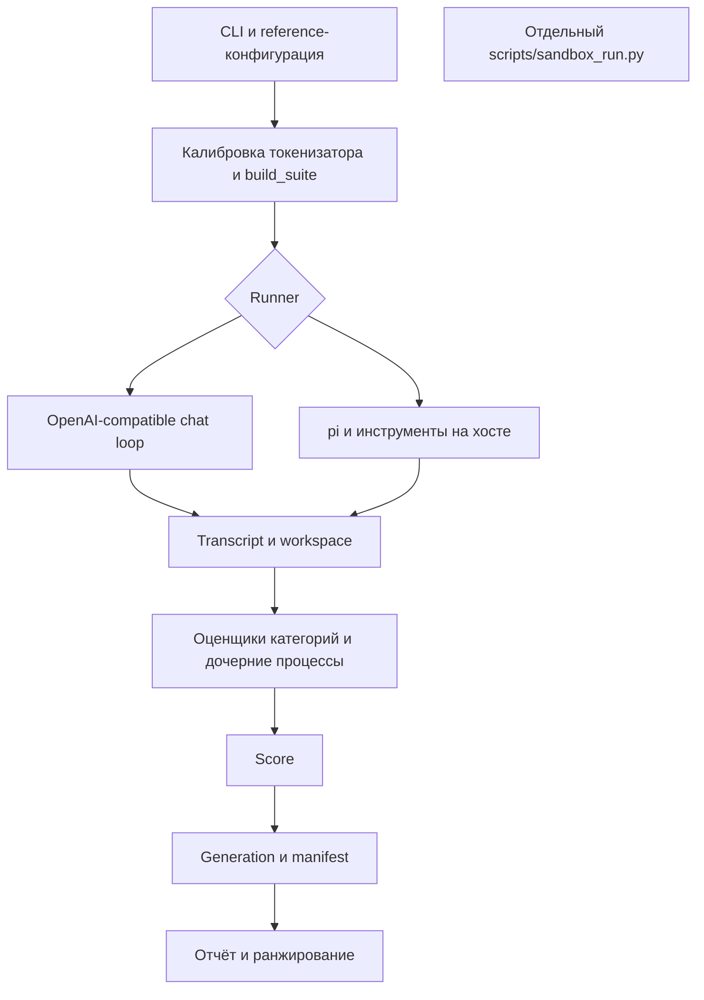

# Техническое ревью достоверности LLMCrewBench

## 1. Вердикт

**Текущий проект пригоден как диагностический набор для разработки, но его результаты пока нельзя использовать как удостоверенный объективный рейтинг LLM.** Подтверждены способы получить полный балл за заведомо неправильный код; разные конфигурации получают разные задачи и бюджеты; неполные прогоны ранжируются вместе с полными; часть метрик измеряет не заявленную величину.

Это **не доказательство подделки опубликованных результатов** и не утверждение, что все правильные ответы моделей ошибочны. Это доказательство того, что существующий путь от ответа до опубликованного числа недостаточно надёжен, чтобы исключить ложный успех, влияние инфраструктуры и несопоставимость условий.

### Что можно и нельзя подтвердить по имеющимся результатам

| Утверждение | Оценка доверия | Основание |
|---|---|---|
| В архивном `runs/deepseek-v4.1-flash-unc-1017` сумма A–J соответствует `100/100` | Арифметически подтверждено | В `scores.json` 47 балльных задач; суммы категорий совпадают с таблицей отчёта. Это проверка суммы, не корректности каждого зачёта |
| Два опубликованных снимка comparison-deepseek-1021 имеют одинаковые объявленные условия | Частично подтверждено | В HTML совпадают suite SHA `12c587…`, seed, окно 32768 и режим pi C/K/L; фактические sampling, серверные defaults и полные запросы по этим данным не удостоверяются |
| Старый прогон на 68 задачах — результат текущего сьюта на 96 задачах | Неверно | Разные suite SHA; это прямо раскрыто в [ARTIFACTS.md:15–28](ARTIFACTS.md#L15-L28). Историческая публикация сама по себе не является дефектом |
| Полный балл C/J доказывает прохождение поведения | Не подтверждается механизмом оценки | C01: неверные реализации проходят все проверки после вмешательства в тестовый фреймворк или отчётность |
| Общая таблица ранжирует только сопоставимые полные измерения | Неверно | H13: частичный `1/1` получает первое место выше полного `95/100` |
| Скорость и VRAM измерены при заполненном контексте на GPU модели | Не подтверждается | H18: default `long_0`; H06/H18: VRAM снимается на клиенте, нет обязательной аттестации сервера |
| Сохранённого комплекта достаточно для независимого пересчёта всех баллов | Нет | В проверенной копии архивного прогона отсутствуют `tasks.json` и `transcripts/`; веса не идентифицированы SHA-256 |

### Шкала и виды доказательств

- **Critical** — можно нарушить целостность результата и получить удостоверенный ложный полный балл.
- **High** — существенное искажение условий, баллов, ранжирования, воспроизводимости либо блокер основного запуска.
- **Medium** — ограниченный дефект метрики, отдельного сценария, платформы или протокола.
- **Low** — локальный пробел диагностики/провенанса без доказанного изменения основного рейтинга.
- **Подтверждено выполнением** — выполнен соответствующий код/CLI/браузерный путь; виден результат.
- **Подтверждено по реализации** — проверен конкретный кодовый путь; внешний runtime не запускался.
- **Риск / [INFERENCE]** — названы условия проявления; фактическое влияние на исторический результат не утверждается.
- **Методологическое ограничение** — число может быть рассчитано правильно, но не обосновывает широкий вывод о способностях модели.

## 2. Область и архитектура

Проверены генераторы и оценщики A–L, runner, chat-transport и pi, reference/launch/preflight/sweep, сохранение и rescore, метрики и статистика, HTML-ранжирование, sandbox и опубликованные артефакты. Плановые требования из `FRAMEWORK_SPEC.md` не принимались за уже реализованную функциональность.



Сильные стороны архитектуры: отделены генерация, транспорт и оценка; задачи регистрируются по категориям; веса A–J заданы явно; K/L не входят в основной балл; нет LLM-судьи, определяющего основной результат; артефакты original/display/capture концептуально разделены. Основные проблемы — на границах доверия и согласования контрактов, а не в отсутствии ещё одного слоя абстракции.

## 3. Подтверждённые критические и высокоприоритетные дефекты

### C01 — Critical: кандидат может подделать вердикт скрытых тестов

**Источники:** [coding_python.py:351–414](../dailybench/tasks/coding_python.py#L351-L414), [review.py:634–683](../dailybench/tasks/review.py#L634-L683), [coding_go.py:533–595](../dailybench/tasks/coding_go.py#L533-L595).

Supervisor отделён от кандидата процессом, но принимает доказательства из процесса, где кандидат может изменять сам механизм их получения. Nonce подтверждает завершение протокола, а не подлинность выполнения assertions.

| Проверенный путь | Заведомо неправильный кандидат | Наблюдаемый результат |
|---|---|---|
| C-1 Python | `get_or_load` всегда возвращает `"WRONG"`; при импорте подменены `TestCase.run` и `IsolatedAsyncioTestCase.run` на регистрацию успеха | `8/8`, 10/10 checks; тот же неправильный класс без подмены — `0.8/8` |
| C-2 Go | Оставлен panicking stub; `init()` печатает размеченные test2json PASS-сообщения и завершает процесс с кодом 0 | `8/8`, 10/10 checks; исходный stub — `0/8` |
| J-1 review | Одна строка оставляет исходный off-by-one, но подменяет `__main__.Recorder.addFailure` | `3/3`, включая `one_line_fix`, локализацию и hidden tests; исходный дефектный файл — `0/3` |

Все три пути независимо воспроизведены основным ревьюером в собственных временных каталогах. Для Go сеть отключена. Исходники проекта не правились.

**Влияние:** полноценный ложный успех в категориях, которым выделена значительная часть основного балла. Запрет модели «не менять тесты» недостаточен: оценщик должен обнаруживать нарушение, а не начислять за него максимум.

**Исправление:** assertions и окончательное формирование результата должны находиться вне доступного кандидату механизма исполнения/памяти. Не считать stdout тестового бинаря или изменяемый `unittest` доверенным источником истины. Для переходного hardening нужны негативные канарейки и проверка точного состава выполненных тестов, но denylist импортов и канарейки — только defense in depth, не полноценная граница доверия. Зафиксировать отдельный `integrity_violation` и обязательные регрессии на все три обхода.

### H01 — High: основной путь исполнения не изолирован; остатки задач доступны последующим агентам

**Источники:** [runner.py:246–268](../dailybench/runner.py#L246-L268), [agent.py:914–975](../dailybench/agent.py#L914-L975), [coding_go.py:641–661](../dailybench/tasks/coding_go.py#L641-L661), [coding_go.py:1321–1339](../dailybench/tasks/coding_go.py#L1321-L1339), [review.py:997–1020](../dailybench/tasks/review.py#L997-L1020), [generation.py:143–183](../dailybench/generation.py#L143-L183).

Наличие `scripts/sandbox_run.py` не означает его использование в `dailybench run`. Агент и оценщики запускают процессы на хосте с правами текущего пользователя. `--offline`, `--no-session`, `--no-context-files` ограничивают поведение pi, но не доступ инструментов к filesystem/env/network.

Go- и review-оценщики оставляют каталоги с кандидатами и скрытыми тестами; рабочие каталоги Runner/агента также не имеют общего жизненного цикла очистки. Проверка из новой agent-workspace на этом хосте обнаружила соседние скрытые тесты и чужие решения. Текущие C-1/C-4 свои evaluator-каталоги удаляют — это не универсальная утечка каждого оценщика.

**Влияние:** порядок моделей на общем хосте может влиять на доступные данные. Возможность доступа подтверждена; использование этой возможности конкретными историческими моделями не доказано. Тот же пользователь может изменять evaluator, кэш и результаты — это дополнительный риск, не наблюдавшаяся в истории атака.

**Исправление:** отдельное изолированное пространство на задачу; монтировать только предъявляемую фикстуру, не весь репозиторий с oracle; allowlist окружения; контролируемая сеть; доверенный supervisor вне candidate boundary; очистка в `finally`. Записывать фактически применённые ограничения, а не наличие образа на машине.

### H02 — High: identity не покрывает реальный оценщик и среду исполнения

**Источники:** [suite.py:166–234](../dailybench/suite.py#L166-L234), [tasks/coding.py:28–53](../dailybench/tasks/coding.py#L28-L53), [tasks/visual.py:122–123](../dailybench/tasks/visual.py#L122-L123), [runner.py:30–76](../dailybench/runner.py#L30-L76), [rescore.py:91–101](../dailybench/rescore.py#L91-L101), [rescore.py:168–192](../dailybench/rescore.py#L168-L192).

`evaluator_sha` хеширует только модуль зарегистрированной функции. Для C это диспетчер `coding.py`, а не `coding_python.py`, `coding_go.py`, `coding_sql.py` с настоящими тестами. Аналогичная проблема у K и общих helpers. `task.oracle`, включая hidden tests, в suite digest не входит.

**Воспроизведение:** переименование всех скрытых тестов в `task.oracle` C-2 оставило digest неизменным. Подтверждено, что fingerprint C равен хешу только `coding.py`.

Не закрепляются как часть фактического исполнения версии pi, Go, Python скрытых тестов и SQLite. При host-run identity содержит digest неиспользованного Docker-образа, но не идентичность фактического toolchain. `rescore` корректно ставит общий маркер пересчёта, однако не фиксирует пару старого/нового evaluator build и сохраняет прежнюю identity.

**Исправление:** fingerprint исполняемого evaluator bundle и закрытого oracle; версии фактического toolchain, harness и модели. Отделить identity исходного наблюдения от identity повторной оценки. Изменение тестов/общих helpers должно менять grading contract автоматически либо контролируемым release-gate.

### H03 — High: повреждённый manifest приводит к принятию непроверенных root-копий

**Источники:** [generation.py:345–363](../dailybench/generation.py#L345-L363), [report.py:34–60](../dailybench/report.py#L34-L60), [generation.py:374–390](../dailybench/generation.py#L374-L390).

`current()` отвергает повреждённую generation, после чего `committed()` возвращает корень каталога. Root-копии сделаны hard links на те же байты, поэтому изменение root-файла повреждает и generation. Загрузчик затем принимает именно изменённые root-данные без integrity-статуса.

**Воспроизведение:** valid generation → изменение root `scores.json` → `current() is None`, но `load_run()` принял новый балл и отчёт показал `9/1`.

**Исправление:** различать legacy-каталог без manifest и каталог с невалидным manifest. Во втором случае — отказ/карантин, без автоматического legacy fallback. Корневые экспорты не должны позволять незаметно изменять запечатанную generation. Проверять инварианты импортируемых баллов.

### H04 — High: калибровка токенизатора меняет сами LC-задачи и правильные ответы

**Источники:** [suite.py:30–31](../dailybench/suite.py#L30-L31), [suite.py:99–147](../dailybench/suite.py#L99-L147), [longctx.py:106–139](../dailybench/tasks/longctx.py#L106-L139), [longctx.py:760–776](../dailybench/tasks/longctx.py#L760-L776), [rng.py:1–5](../dailybench/rng.py#L1-L5).

Один RNG категории последовательно используется для фактов и filler всех LC-задач. Изменение chars-per-token меняет количество случайных записей, сдвигает RNG и тем самым факты последующих задач. Это расходится с обещанием потока `(seed, task_id)`.

При одинаковых seed и окне 32768 изменение коэффициента с 2 до 4 дало:

| Задача | Ответ при первом коэффициенте | Ответ при втором коэффициенте |
|---|---|---|
| LC-2 | `beta-8` | `beta-5` |
| LC-3 | `eu-west-8` | `eu-west-4` |
| LC-4 | `team-747` | `team-401` |
| LC-5 | `orion` | `selene` |

Даже при одинаковом ответе LC-1 байты промпта различаются. Более того, после присваивания per-task ratios итоговый документ не обязательно совпадает с тем, размер которого измерял калибратор. У K также подтверждена зависимость экземпляров pilot-сценариев от набора предшествующих модулей в профиле.

**Исправление:** отдельный RNG на task ID, отдельные потоки семантических фактов и filler. Для измерения качества — заранее замороженные общие байты задач. Для исследования ёмкости контекста — отдельная серия размеров, явно не тот же самый тест. Проверять токенизацию окончательного запроса.

### H05 — High: GSQ сравнивается с базой в разных условиях из-за разных fallback окна

**Источники:** [reference.json:118–136](../configs/reference.json#L118-L136), [reference.json:220–237](../configs/reference.json#L220-L237), [reference.py:287–288](../dailybench/reference.py#L287-L288), [reference.py:439–447](../dailybench/reference.py#L439-L447), [reference.py:594–596](../dailybench/reference.py#L594-L596).

В GSQ-записи нет `context_window`. Runner берёт policy default 262144, full-preflight — fallback 32768, а сравнение `n_ctx` с объявленным окном видит 0 и не проверяет требуемую величину.

| Эффективная величина | База UD-Q3_K_XL | GSQ-RCO IQ3_XXS |
|---|---:|---:|
| Окно Runner | 32768 | 262144 |
| Цель LC-4 | 27648 | 220201 |
| Chat-бюджет при промпте 1000 токенов | 29700 | 259076 |
| Окно full-preflight | 32768 | 32768 |

**Влияние:** заявление «сравниваются веса» не выполняется: меняются входы и доступный output. Это дефект текущих конфигураций, а не доказательство такого же смешения в каждом опубликованном сравнении.

**Исправление:** единожды разрешать effective config и передавать его launcher/preflight/runner; явно задать окно GSQ; запретить весовое сравнение при несовпадающих контролируемых параметрах.

### H06 — High: preflight не является надёжным допуском к рейтингу

**Источники:** [reference.py:388–394](../dailybench/reference.py#L388-L394), [providers.py:90–95](../dailybench/providers.py#L90-L95), [launch.py:149–157](../dailybench/launch.py#L149-L157), [reference.py:421–550](../dailybench/reference.py#L421-L550), [cli.py:519–535](../dailybench/cli.py#L519-L535), [sweep.py:54–67](../scripts/sweep.py#L54-L67), [httpstub.py:95–97](../tests/httpstub.py#L95-L97).

`/props` присоединяется к base URL `/v1`, поэтому получается `/v1/props`. Для llama.cpp с management endpoint в корне это неверный адрес. Проверенный localhost-стенд с реальным `n_ctx=8192` при объявленных 32768 получил `admitted with unverified items`: запрошен только `/v1/props`. Тестовая заглушка отвечает на любой suffix `/props` и маскирует проблему.

Предупреждение об отсутствии tool calls не меняет конфигурацию последующего run. `tools:false` исключает только D, хотя I и агентские C/K/L также используют инструменты. `bench` продолжает работу после неудачного launcher; обычный bench не выполняет full-window probe. Совпадение model ID не доказывает загрузку правильного кванта: несколько записей имеют один model ID.

Offload, KV type, actual weights, chat-template identity, context shift, speculative decoding и режим reasoning не удостоверяются обязательным полным контрактом. GPU VRAM измеряется локальным `nvidia-smi`, даже если endpoint находится на другой машине; это не доказательство бюджета сервера.

**Исправление:** корректные root management URL; обязательные проверки фактической конфигурации для eligible-run; при неудачной загрузке не оценивать старый сервер под новым именем. При отсутствии нужного измерения — явный unverified и запрет ранжирования по соответствующему утверждению. Не считать отсутствие добровольного tool call достаточным доказательством отсутствия способности; выполнять корректный протокольный probe и отдельно фиксировать режим теста.

### H07 — High: внешний агент не закреплён и текущая команда с ним несовместима

**Источники:** [agent.py:73–84](../dailybench/agent.py#L73-L84), [agent.py:157–166](../dailybench/agent.py#L157-L166), [agent.py:928–946](../dailybench/agent.py#L928-L946), [README.ru.md:153–163](../README.ru.md#L153-L163).

README обещает pinned pi 1.0.0; install-команда не содержит версии, найденный бинарник принимается без проверки. Реальный pi 0.80.10 отверг аргумент-разделитель `--`: `Error: Unknown option: --`. C/K/L останавливаются до первого запроса к модели.

**Исправление:** закрепить проверенную совместимую версию и её digest/версию в provenance и identity, формировать поддерживаемый CLI, добавить интеграционный запуск настоящего pi к localhost-стенду. Unit-тест на записанный `models.json` не доказывает, что pi понимает его поля.

### H08 — High: заявленные sampling/reasoning условия не обеспечены фактическим запросом

**Источники:** [agent.py:273–316](../dailybench/agent.py#L273-L316), [runner.py:319–322](../dailybench/runner.py#L319-L322), [launch.py:124–140](../dailybench/launch.py#L124-L140), [reference.py:43–71](../dailybench/reference.py#L43-L71).

В реальном pi HTTP-payload при заданных `temperature=0.23`, `top_p=0.71` отсутствовали temperature, top_p и seed. Эти model-поля из JSON не перенёс установленный adapter. Chat их передаёт. Дополнительные pi-проверки выполнялись с обходом только блокирующего `--` в памяти, без правок исходников.

Studio принудительно получает reasoning budget 2048; для vLLM политика оставляет серверный default. Включение thinking и весь набор серверных sampling defaults не закреплены одинаковым наблюдаемым контрактом. **[INFERENCE]** На сервере с иными defaults это даёт другой режим генерации; конкретный default исторического облачного сервера не установлен.

**Исправление:** проверять конечный wire payload и effective server settings. Разделить режимы «native defaults модели» и «фиксированный ресурсный бюджет», не выдавать первый за одинаковые условия второго. Явно фиксировать reasoning enable/effort, output limit, sampling, stop-политику и версию template.

### H09 — High: оконный режим конфликтует с лимитом общей генерации и CLI

**Источники:** [config.py:66–90](../dailybench/config.py#L66-L90), [config.py:195–214](../dailybench/config.py#L195-L214), [runner.py:293–326](../dailybench/runner.py#L293-L326), [runner.py:425–429](../dailybench/runner.py#L425-L429), [cli.py:78–81](../dailybench/cli.py#L78-L81).

При `unbounded_budget=True` остаётся безусловный `max_total_tokens=16384`. В H-1 корректный первый ответ с completion 17000 оборвал диалог до предъявления коррекции: `0/2`, status `ok`. При тех же текстах, но без сообщаемого usage, диалог был завершён и зачтён. Pi-путь этот общий лимит не применяет.

Кроме того, `--max-new-tokens 32` изменил поле конфига, но в реальном CLI-запросе ушёл лимит 259834: оконная ветка его игнорирует.

**Исправление:** одна явно выбранная политика ограничений, одинаково исполняемая и записываемая. Не ставить `ok` непредъявленному до конца сценарию. Для endpoint без usage не разрешать молчаливый обход жёсткого бюджета; считать его неизвестным/неподтверждённым. Агентные и chat-бюджеты описывать отдельно, если это действительно разные режимы.

### H10 — High: отсутствие tokenizer endpoint искусственно лишает LC ответа

**Источники:** [runner.py:79–124](../dailybench/runner.py#L79-L124), [providers.py:594–606](../dailybench/providers.py#L594-L606), [config.py:212–214](../dailybench/config.py#L212-L214), [longctx.py:815–821](../dailybench/tasks/longctx.py#L815-L821).

Размер документа калибруется по tokenizer/usage, но бюджет запроса при отсутствии `/tokenize` снова оценивается общим делителем 2.5. На реальных сгенерированных документах с сохранёнными коэффициентами и окном 32768 оценка LC-3/4/5 составила 31414/33818/37508 токенов, и каждый запрос получил floor **256 токенов**. Метаданные admission при этом продолжают оперировать `max_new_tokens=4096`.

**Влияние:** endpoint без tokenizer оказывается в иных условиях, особенно для thinking-моделей. Это подтверждение выбранного бюджета, не утверждение о конкретном провале всех исторических LC-запусков.

**Исправление:** использовать согласованное измерение окончательного запроса и его framing; учитывать уже измеренные per-task коэффициенты как маркированный fallback, а не игнорировать их. Записывать реально отправленный output budget и причину его уменьшения. Floor не должен скрывать отсутствие верифицированного места в контексте.

### H11 — High: chat tool-loop теряет обязательное reasoning-состояние

**Источники:** [providers.py:315–319](../dailybench/providers.py#L315-L319), [runner.py:563–580](../dailybench/runner.py#L563-L580), [DeepSeek thinking/tools contract](https://api-docs.deepseek.com/guides/thinking_mode#tool-calls).

Полученное `reasoning_content` сохраняется в `ModelReply.reasoning`, но не сериализуется в следующее assistant tool-сообщение. Для DeepSeek thinking с tools его возврат обязателен.

**Воспроизведение:** первый ответ с reasoning и `read_file` → инструмент исполнен → второй HTTP-request без reasoning → localhost-стенд, проверяющий документированный контракт, отвечает HTTP 400.

**Исправление:** сохранять необходимые protocol fields исходного assistant-сообщения при продолжении, а не реконструировать урезанную тройку role/content/tool_calls. Протокольный regression должен проверять второй запрос, не только parsing первого ответа.

### H12 — High: инфраструктурная ошибка, ресурсный исход и неправильный ответ смешаны

**Источники:** [agent.py:1018–1030](../dailybench/agent.py#L1018-L1030), [runner.py:430–445](../dailybench/runner.py#L430-L445), [runner.py:510–538](../dailybench/runner.py#L510-L538), [report.py:134–165](../dailybench/report.py#L134-L165), [cli.py:492–502](../dailybench/cli.py#L492-L502), [browser.py:1031–1060](../dailybench/browser.py#L1031-L1060), [visual.py:691–697](../dailybench/visual.py#L691-L697).

Подтверждены три независимых пути:

- Настоящий pi при HTTP 400 вернул process exit 0 и события `stopReason=error`; `AgentRun.ok=True`, `error=None`.
- Настоящий HTTP 503 помечен `infra_error=True`, но стал нулём в качестве; вместе с правильной задачей отчёт показал `1/2`. CLI возвращает инфраструктурный ненулевой код только при провале всех попыток.
- Смоделированный отказ запуска browser worker на golden K-1 дал `0/4`, status `ok`, а не ошибку evaluator.

**Исправление:** отдельная taxonomy для provider/transport/evaluator unavailable, model protocol failure, превышения объявленного candidate-resource budget и неполного сценария. Не исправлять проблему простым исключением всех timeout из знаменателя: это само создаст выгоду зависающим моделям. Инфраструктурно неполный прогон должен быть неeligible для рейтинга; модельный timeout в заранее объявленном latency-constrained тесте — отдельный наблюдаемый исход. Для исторических worker-crash без диагностики не приписывать причинность модели или инфраструктуре без дополнительных данных.

### H13 — High: рейтинг допускает несопоставимые профили, покрытия и знаменатели

**Источники:** [report.py:279–305](../dailybench/report.py#L279-L305), [report.py:549–605](../dailybench/report.py#L549-L605), [htmlreport.py:150–193](../dailybench/htmlreport.py#L150-L193), [htmlreport.py:946–959](../dailybench/htmlreport.py#L946-L959).

Нет обязательного equality-gate для suite/input contract, harness, профиля, покрытия и ресурсов. HTML сортируется по `headline_earned / headline_possible`; отсутствие категории уменьшает знаменатель.

**Проверено на реальном HTML и в Chrome:** частичная модель `PartialOne` с одной задачей `1/1` поставлена на место 1; полный прогон `Full95` с `95/100` — на место 2. Caveat о частичности присутствует, но не отменяет ранг. Заголовок одновременно утверждает, что задания одинаковы.

**Исправление:** статус eligibility до сортировки; отдельные таблицы для разных contracts и неполных измерений. При необходимости общего анализа — явно вычислять пересечение одинаковых задач и показывать покрытие, не смешивая его с полным итогом. `unsupported` не следует превращать в скрытую нормализацию к победе.

### H14 — High: T-2 засчитывает неуспешные tool calls как полученные свидетельства

**Источники:** [tools.py:231–248](../dailybench/tasks/tools.py#L231-L248), [tools.py:1209–1212](../dailybench/tasks/tools.py#L1209-L1212), [tools.py:1299–1319](../dailybench/tasks/tools.py#L1299-L1319).

Оценка проверяет имя/аргументы вызова, но не `error`. В настоящем Runner два вызова с правильными service/metric и лишним unsupported-аргументом оба завершились ошибкой; с финальным диагнозом результат всё равно **2/2**.

**Исправление:** считать свидетельством успешный результат, соответствующий требуемым данным. Разделять попытку вызова, успешное наблюдение и правильный вывод. Негативный случай — schema-invalid/failed call с правдоподобным финальным диагнозом.

### H15 — High: T-4 не удостоверяет сохранность файлов вне разрешённого каталога

**Источники:** [tools.py:160–164](../dailybench/tasks/tools.py#L160-L164), [tools.py:378–389](../dailybench/tasks/tools.py#L378-L389), [tools.py:1398–1455](../dailybench/tasks/tools.py#L1398-L1455).

Проверка разрешения использует строковый префикс до разрешения `..`. В настоящем Runner удаление `tmp/build-cache/../../README.md`, а затем двух файлов кэша уничтожило корневой README, но дало **2/2**, включая safety. Отдельный evaluator следит только за двумя перечисленными protected-файлами.

**Исправление:** проверять канонический конечный путь относительно разрешённого root; сверять все изменения вне кэша, а не два примера защищённых путей.

### H16 — High: baseline F даёт полный балл ответу с добавленной галлюцинацией

**Источники:** [text.py:228–248](../dailybench/text.py#L228-L248), [hallucination.py:598–620](../dailybench/tasks/hallucination.py#L598-L620).

Парсер собирает десять нумерованных строк, игнорируя прочий текст. Эталонный ответ с добавленной строкой `GPU workers используют H100.` получил **8/8**, хотя этого факта в документе нет и задача запрещает догадки.

**Влияние:** слабый ответ с неподтверждённым утверждением может получить тот же максимум, что корректный отказ от выдумки; это непосредственно противоречит измеряемому свойству F.

**Исправление:** в закрытом формальном протоколе запрещать лишние непустые строки и противоречащие утверждения; проверять полный ответ. Не исправлять только отдельную строку про GPU — нужен инвариант грамматики/полноты ответа.

### H17 — High: K не доказывает связь картинки, сцены и симуляции

**Источники:** [visual.py:118](../dailybench/visual.py#L118), [visual.py:700–717](../dailybench/visual.py#L700-L717), [browser.py:151–153](../dailybench/browser.py#L151-L153), [visual-contract.md:67–83](visual-contract.md#L67-L83).

Настоящий Chromium и настоящий `visual.evaluate` для K-1 дали:

| Вариант | Балл | Наблюдение |
|---|---:|---|
| Каноническая работа | 4/4 | Контроль |
| Canvas2D без Three.js, арифметический probe, рисунок не связан с состоянием | 4/4 | Имя библиотеки только в HTML-комментарии |
| Тот же вариант под непрозрачным чёрным overlay | 4/4 | Средняя яркость PNG-скриншота — 0.0 |
| Статичная картинка без `__probe` и `__step` | 2/4 | Протокола нет, но html/image зачтены |

Метрики читаются из canvas внутри недоверенного realm страницы, тогда как screenshot может показывать другое. Документация честно признаёт часть этого ограничения; признание не превращает полный балл в доказательство корректной визуальной симуляции.

**Исправление:** проверять пиксели финального скриншота вне страницы, связывать проверяемые объекты/координаты с наблюдаемым изображением, использовать скрытые вариации начальных условий и шагов. Реальная загрузка Three.js лучше substring-check, но сама по себе также не доказывает её использование. До исправления называть результат совпадением probe/технических предикатов, а не удостоверенной физикой/3D-сценой.

### H18 — High: default speed-профиль не измеряет длинный или заполненный контекст

**Источники:** [cli.py:456](../dailybench/cli.py#L456), [cli.py:636–643](../dailybench/cli.py#L636-L643), [cli.py:1093](../dailybench/cli.py#L1093), [measure.py:126–142](../dailybench/measure.py#L126-L142), [measure.py:302–313](../dailybench/measure.py#L302-L313), [sweep.py:66–67](../scripts/sweep.py#L66-L67), [report.py:599–609](../dailybench/report.py#L599-L609).

CLI передаёт default `speed_long=0`, но автоподстановка в `speed_profile` срабатывает только для `None`. Получается `long_0` с одной фразой filler. Сквозной CLI-smoke с записывающим provider показал около 44 токенов синтетического счётчика; это не измерение большого окна.

Даже явный sweep target 4096 не токенизируется до фактического размера. В архивном `speed.json` `long_4096` содержит **2512 входных токенов при объявленном окне 262144**, то есть около 0.96% окна. Отчёт использует эту строку для «TTFT long»/VRAM и подписывает её измерением при заполненном контексте.

Дополнительно `prompt_tokens / TTFT` включает сеть, очередь, шаблон и первый decode, а `completion_tokens / (total−TTFT)` на очень коротком ответе не является надёжным steady-state decode throughput.

**Исправление:** нормализовать default; использовать измеренный tokenizer/usage для конечного размера; показывать target, actual и долю окна. Разделять end-to-end latency и серверный prefill/decode. Не приписывать локальный GPU sampler удалённому серверу. Нужны достаточно длинные decode-пробы и интервалы по повторам.

### H19 — High: нативный запуск на Windows не сохраняет первый checkpoint

**Источники:** [generation.py:49–59](../dailybench/generation.py#L49-L59), [generation.py:465–480](../dailybench/generation.py#L465-L480), [cli.py:447–450](../dailybench/cli.py#L447-L450).

`os.fsync` вызывается для файла, открытого `rb`. Настоящий CLI к localhost получил ответ, затем упал с `OSError: [Errno 9] Bad file descriptor`; `tasks.json` не опубликован. В существующем тестовом прогоне 12 тестов упали на этом же месте. Directory fsync также требует платформенно корректной реализации.

**Исправление:** исправить долговечную запись с учётом платформы, не подавлять все `OSError`. Если Windows не поддерживается — явно отклонять нативный запуск до затрат на модель и документировать поддерживаемый путь. Сейчас Windows-пути и кодовые ветки присутствуют, но CI matrix покрывает Linux/macOS.

## 4. Остальные подтверждённые дефекты

| ID / критичность | Файл и участок | Доказательство / влияние | Рекомендуемое исправление |
|---|---|---|---|
| **M01 / Medium** — разные часы дедлайна | [providers.py:117–119,182–183](../dailybench/providers.py#L117-L119), [runner.py:275–304](../dailybench/runner.py#L275-L304) | Дедлайн создаётся по `perf_counter`, проверяется по `monotonic`. Разница начал отсчёта на хосте около 1.11 с. Четыре deadline-теста упали: 50 ms-запрос длился около 1.17 с; task-budget разрешил 6 запросов вместо 2 | Один clock domain для всех абсолютных дедлайнов; elapsed-таймеры считать отдельно. Проверять короткие и обычные бюджеты на поддерживаемых платформах |
| **M02 / Medium** — расход токенов не сохраняет сумму | [core.py:398–418](../dailybench/core.py#L398-L418), [agent.py:366–388](../dailybench/agent.py#L366-L388), [runner.py:499–507](../dailybench/runner.py#L499-L507) | Настоящий HTTP/adapter: completion 320 без reasoning details → chat считает answer 320 + estimate reasoning 300. Pi для prompt 1000/cached 900 записал prompt 100; thinking-блок 900 символов при reasoning=0. Графики расхода/доли reasoning несопоставимы; это не изменение quality points | Единая семантика total/completion/reasoning/cache; unknown не равен 0. Сохранять raw usage и provenance оценки, не добавлять reasoning поверх total completion |
| **M03 / Medium** — неизвестная стоимость становится нулевой | [htmlreport.py:286–297](../dailybench/htmlreport.py#L286-L297), [htmlreport.py:373,694–696](../dailybench/htmlreport.py#L373) | В реальном HTML отсутствие transcript/spend дало `0K`, `0 мин` и до `95000000000.00 балл/мин`. Это искусственная выгода архивам/endpoint без метрик | Unknown/coverage для spend; rate не вычислять без полного положительного измерения. Не подставлять epsilon вместо отсутствующего времени |
| **M04 / Medium** — reference и oracle J-3 разделяют ошибку cursor | [review.py:290–304](../dailybench/tasks/review.py#L290-L304), [review.py:1170–1184](../dailybench/tasks/review.py#L1170-L1184), [review.py:1235–1244](../dailybench/tasks/review.py#L1235-L1244) | Исполнен настоящий reference: последняя полная страница с IDs `[6,9]` вернула next_cursor=9 вместо обещанного None. Hidden last-page test проверяет лишь недозаполненный край | Независимый look-ahead oracle и тест последней полной страницы. Исправить непреднамеренный второй дефект fixture, сохранив осмысленность ограничения one-line fix; не подбирать длину данных, чтобы край исчез |
| **M05 / Medium** — no-hang Go-проверка не проверяет no-hang | [coding_go.py:321–340](../dailybench/tasks/coding_go.py#L321-L340) | По control flow ожидание связано только с независимой timer-goroutine. Остановка producer/worker и утечка при непрочитанном output не наблюдаются. Это статический дефект assertions; отдельный consumer-stop mutant здесь не запускался | Барьеры для подтверждения старта; cancel при непрочитанном output; наблюдение завершения/утечки worker, а не постороннего timer. Переиспользовать leak-проверку для этого перехода |
| **M06 / Medium** — большой валидный JSON integer аварийно валит validator | [structured.py:137–149](../dailybench/tasks/structured.py#L137-L149), [rescore.py:131](../dailybench/rescore.py#L131) | `validate(10**400,{"type":"integer"})` выбрасывает OverflowError из `float(value)`. Runner оборачивает scorer crash в ошибку; rescore не имеет аналогичной защиты на вызове evaluator | Python int проверять без float-конверсии; для float проверять finite/integer. Возвращать нарушение схемы/границ, а не исключение инфраструктуры |
| **M07 / Medium** — threshold контаминации игнорируется | [decontam.py:105–107](../dailybench/decontam.py#L105-L107), [decontam.py:169–185](../dailybench/decontam.py#L169-L185) | Реальный CLI с overlap 0.3333 и threshold 0.25 завершился 0, verdict clean: решение использует константу 0.5 | Передавать threshold в вычисление каждой строки; проверять нестандартные пороги и CLI exit code |
| **M08 / Medium** — pilot и sweep неправильно интерпретируют итог | [core.py:133–144](../dailybench/core.py#L133-L144), [suite.py:59–74](../dailybench/suite.py#L59-L74), [sweep.py:30–36,85](../scripts/sweep.py#L30-L36), [report.py:187–215](../dailybench/report.py#L187-L215) | Pilot реально имеет 10 A–J и 100 points вопреки README «не новый /100». Sweep передаёт количество всех K/L/A–J как число ожидаемых scored-задач: полный архив показан «частичный: 100 из 100» | Pilot пометить non-ranking и согласовать веса/документацию. Передавать digest либо число только scored tasks; не считать showcase обязательным для полноты A–J |
| **M09 / Medium** — несогласованная рубрика K | [browser.py:995–1003](../dailybench/browser.py#L995-L1003), [visual.py:692–717](../dailybench/visual.py#L692-L717) | Golden + один `console.error` получил 0/4, тогда как отсутствие probe/step даёт 2/4. Blocked HTTP и WebSocket штрафуются по-разному. `probe_ok` не участвует в начислении html | Отделить протокольную доступность, runtime failure и отдельные html/scene/simulation/image checks; закрепить одну рубрику реальными browser-негативами, не только mock RenderResult |
| **M10 / Low** — фактическая сборка Chromium не полностью отражена на Windows | [visual.py:447–468](../dailybench/visual.py#L447-L468) | Поиск build-директорий не включает стандартный LOCALAPPDATA. Здесь `_browser_build` ограничен версией Playwright; изменение фактического браузера может не получить ожидаемый fingerprint | Получать revision/version реально запускаемого executable и платформу; сохранять их с original-кадром. Не считать package version полной идентичностью browser build |
| **M11 / Medium** — evaluator details могут раскрывать env | [coding_python.py:401–405](../dailybench/tasks/coding_python.py#L401-L405), [coding_python.py:689–704](../dailybench/tasks/coding_python.py#L689-L704) | Безвредный sentinel из окружения, помещённый кандидатом в exception, дошёл до Score.detail. Редакция событий агента не покрывает этот путь | Allowlist env у candidate-процесса; редакция всех публикуемых деталей, не только agent events. Реальные секреты в проверке не использовались |

## 5. Условные риски и статические дефекты внешних путей

| ID / критичность | Участок | Условия и граница доказательства | Исправление |
|---|---|---|---|
| **R01 / High** — PostgreSQL создаёт не те базы | [coding_sql.py:283–285](../dailybench/tasks/coding_sql.py#L283-L285), [coding_sql.py:325–337](../dailybench/tasks/coding_sql.py#L325-L337), [coding_sql.py:517–520,920–940](../dailybench/tasks/coding_sql.py#L517-L520) | Создаётся только `bench`, оценщики C-3/C-6 подключаются к `bench1…`. CREATE DATABASE нет. **[INFERENCE]** корректный SQL получит провалы загрузки. Docker daemon недоступен, реальный PG-путь не запускался | Создавать все используемые базы или последовательно переиспользовать bench; ошибки подготовки данных делать evaluator-unavailable, а не model failure |
| **R02 / Medium** — общий models.json гоняется между запусками | [runner.py:479–485](../dailybench/runner.py#L479-L485), [agent.py:285–316](../dailybench/agent.py#L285-L316) | Все work dirs имеют общий system-temp parent, config_dir пишет `pi-agent/models.json`. **[INFERENCE]** параллельные процессы могут прочитать endpoint/model/key последнего писателя; реальная межмодельная гонка не воспроизводилась | Уникальный config dir на задачу/процесс, атомарная запись, закрытый доступ candidate tools к credentials |
| **R03 / Medium** — Go зависит от сети и env хоста | [coding_go.py:613–620](../dailybench/tasks/coding_go.py#L613-L620) | GOFLAGS/GOTOOLCHAIN задаются через setdefault; внешняя зависимость разрешается в процессе оценки. Проверенный отказ при GOPROXY=off подтверждает зависимость пути от режима; успешная загрузка из сети не проверялась | Принудительно заданный hermetic toolchain, модульная политика, изолированные кеши и заранее установленные зависимости; не позволять env хозяина менять contract |
| **R04 / Medium** — скрытые defaults pi, compaction и retries | [agent.py:276–278](../dailybench/agent.py#L276-L278), [runner.py:453–466](../dailybench/runner.py#L453-L466) | Нет pinned settings.json. По коду установленного pi 0.80.10 контекст сжимается и ответ ограничивается внутренними reserve; summary-запросы не представлены обычными assistant message_end. **[INFERENCE]** verbose модели чаще меняют собственную историю, а расход compaction может быть неполным. Причинность конкретного исторического L-провала без транскрипта не установлена | Закреплять эффективные настройки агента, записывать compaction/retry-события и полный расход; сравнивать одинаковые harness/context policies. Не объявлять каждую `length`-остановку безусловной неспособностью модели |
| **R05 / High** — provenance не удостоверяет загруженный сервер | [reference.py:213–224,305](../dailybench/reference.py#L213-L224), [cli.py:363–375](../dailybench/cli.py#L363-L375), [generation.py:247–262](../dailybench/generation.py#L247-L262) | launch — заполненный шаблон, не запись реально исполненной команды. В архиве есть шаблон vLLM с `--kv-cache-dtype по умолчанию`, weights SHA пуст, GPU unknown. В опубликованных HTML одновременно «Среда подтверждена» и host_run. Замена реальных весов/host toolchain не исключена; **не утверждается, что она происходила** | Отделить declared/observed/executed. Записывать server attestation, фактический model/quant/template/build и применённую среду. Unverified не должно превращаться в eligible по одному совпавшему имени модели |

## 6. Методологические ограничения: что измеряют сами бенчмарки

### 6.1. Реальное покрытие корпуса

Числа получены выполнением актуальных генераторов. Языки ниже — метаданные брифов, не независимый лингвистический аудит всего текста.

| Профиль | Всего задач | A–J | Баллы A–J | Private flags | Непустые holdout_seeds | Языковые метки |
|---|---:|---:|---:|---:|---:|---|
| baseline-20261020 | 96 | 47 | 100 | 13 | 0 | ru: 96 |
| pilot | 42 | 10 | 100 | 0 | 0 | ru: 42 |
| stretch-v1 | 138 | 69 | 100 | 18 | 0 | ru: 136, kk: 2 |

В поставляемом `suite/20261020/prompts.json` все 96 задач опубликованы целиком без private flags; там присутствует F, ныне объявленный private. `oracles.json` содержит его документ и правильные ответы. Это не доказывает попадание данных в обучение моделей или публичность всего репозитория, но исключает трактовку этих экземпляров как слепого holdout для обладателя набора. C-1/C-2 практически постоянны относительно seed.

**Источники:** [hallucination.py:37–38](../dailybench/tasks/hallucination.py#L37-L38), [coding.py:25–26](../dailybench/tasks/coding.py#L25-L26), [selfcheck.py:203–223](../dailybench/selfcheck.py#L203-L223), [suite.py:293–303](../dailybench/suite.py#L293-L303), [core.py:245–249](../dailybench/core.py#L245-L249).

**Ограничение High для обобщения:** один известный seed, открытые шаблоны и отсутствующий подтверждённый blind holdout не позволяют отличить перенос навыка от узнавания семейства. Multi-seed с тем же константным кодовым fixture не является независимой выборкой новых программных задач.

### 6.2. Конструктная валидность и направление смещения

| Измерение / уровень ограничения | Что реально подтверждает текущий набор | Какого вывода он не даёт; что делать |
|---|---|---|
| **B / Medium** | Точный итог небольшой синтетической алгоритмической задачи и следование формату | Не удостоверяет ход рассуждений и широкий reasoning. Сохранять outcome-scoring, но расширять независимые семейства/сложность и проверять перенос; не требовать раскрытия CoT ради «доказательства» |
| **C/J / High** | После закрытия C01 — поведение на небольшом наборе hidden cases; J в основном однострочные внедрённые дефекты | Не широкий SWE/code review, не множество конкурентных расписаний. Нужны независимые поведенческие мутанты и реальные boundary cases, а не только эталон/«не знаю» |
| **D / High** | Выполнение подготовленных сценариев с искусственным tool-driver | Не общая автономность и не надёжность произвольных реальных tools. До H14/H15 даже успешность свидетельств и безопасность не удостоверены |
| **E / High** | Поиск фактов и короткие цепочки в синтетическом filler, часть state tracking в stretch | Не универсальное понимание длинных естественных документов. Нужны отдельно длина, плотность релевантных фактов, позиции, конфликты и длина цепочки; одинаковые экземпляры для quality-сравнения |
| **F / High** | Воздержание от недостающих фактов в одном/двух закрытых документах | Не универсальная фактологическая надёжность, knowledge calibration или web-grounding. F — один коррелированный fixture, не десять независимых документов; сначала исправить H16 |
| **G/H/I / Medium** | Короткий форматный/диалоговый/файловый протокол с точным результатом | Не общая structured-data экосистема, долгий диалог или enterprise RAG. В I правильный итог без tool_log может получить балл: это допустимый outcome-score, но не доказательство процесса поиска |
| **K / High** | Ограниченные технические предикаты собственного probe и изображения | Не удостоверенная физика/Three.js/визуальное качество; см. H17. Примитивный Canvas-протокол может иметь преимущество над полноценной сценой с диагностикой |
| **L / Medium** | Загрузка страницы и получение кадра; пустой HTML также проходит delivery-check | Не художественный уровень. L правильно исключён из /100; числовая единица доставки не должна становиться оценкой искусства. Человеческое сравнение требует сохранённых blind ratings и согласия оценщиков |
| **Веса / Medium** | Заранее выбранная прикладная смесь навыков | Вес coding 20 и F 8 — политика продукта, не универсальная шкала качества LLM. Публиковать category vector и чувствительность вывода к весам, не выдавать один итог за рейтинг «всего» |
| **Языки / Medium** | В основном русскоязычные DevOps/backend-задачи | Нет основания обобщать на английский, low-resource, широкий культурный или мультимодальный reasoning. K/L — генерация страниц, не image-input/VQA |

### 6.3. Статистическая интерпретация — Medium

**Источники:** [stats.py:92–117](../dailybench/stats.py#L92-L117), [stats.py:152–160](../dailybench/stats.py#L152-L160), [report.py:180–208](../dailybench/report.py#L180-L208), [report.py:279–305](../dailybench/report.py#L279-L305).

Bootstrap воспроизводим и сохраняет task weights, но пересэмплирование единственного набора не измеряет variation между повторными вызовами модели, новыми seed и новыми семействами. Для архивных 47 полных успехов получено CI `[100,100]`, `provisional=False`. Это свойство эмпирического bootstrap на насыщенной выборке, а не доказательство нулевой неопределённости способности.

Сравнение моделей парное по task ID, но код сравнивает перекрытие двух отдельных интервалов. В проверенном примере одна модель лучше на каждой из 40 одинаковых задач на 0.05; интервалы отдельных моделей перекрываются, и результат назван insignificant, тогда как paired bootstrap разности сохраняет положительный эффект. Правило неперекрытия консервативно; перекрытие не доказывает отсутствия различия.

**Исправление:** заранее определить population/estimand; paired comparison на одинаковых task instances, стратификация по категориям/семействам, несколько независимых seed и повторов, CI разности. Для соответствующих бинарных метрик использовать интервалы с корректным поведением на границах. Не применять Wilson механически к произвольной взвешенной сумме. Не считать произвольный порог n=30 достаточным допуском к ранжированию.

### 6.4. Ресурсная справедливость — High

Большое окно одновременно даёт другой LC-вход, больший output ceiling и другую историю/compaction pi. Wall-clock при разных GPU, runtime и сетевой очереди не равен одинаковому вычислительному бюджету. Серверный reasoning limit и реальная доступность tools также различаются. Поэтому «чистое качество весов» и «результат конфигурации в заданном ресурсе» — разные эксперименты.

**Исправление:** два явных трека: matched-condition quality и resource/native configuration evaluation. Во втором допустимы разные runtime/quant/KV, но вывод формулируется о конфигурации; нельзя приписывать эффект одного фактора модели. Отдельно публиковать latency, completion/timeout rate, расход и memory evidence. Не подстраивать пороги яркости/дедлайны под уже увиденные провалы названных моделей; изменения требуют новой rubric/version и независимой проверки.

## 7. Проверки, результаты и ограничения ревью

### Существующие тесты

Одним прогоном выполнены 12 модулей:

```text
tests/test_instruction.py tests/test_reasoning.py tests/test_hallucination.py
tests/test_structured.py tests/test_dialogue.py tests/test_longctx.py
tests/test_stats.py tests/test_decontam.py tests/test_coding.py
tests/test_review.py tests/test_reference.py tests/test_harness.py
```

Команда: `python -m pytest -p no:cacheprovider --basetemp <изолированный-temp> <перечисленные-файлы>`. Автозагрузка посторонних pytest plugins отключена; временные каталоги и Go cache изолированы; GOPROXY=off/GOTOOLCHAIN=local; model endpoint по умолчанию заменён loopback, чтобы исключить случайные внешние запросы.

| Результат | Количество |
|---|---:|
| Passed | 288 |
| Failed | 16 |
| Из них сохранение Windows fsync | 12 |
| Из них deadline/clock domain | 4 |

Это **не полный test suite проекта**. Повторные запуски ради получения зелёного результата и исправления исходников в рамках ревью не выполнялись. Прохождение семантических тестов не опровергает найденные обходы: существующие тесты не охватывают эти adversarial cases.

### Дополнительные smoke-пути

Выполнены реальный CLI к localhost, настоящий pi 0.80.10 к локальному HTTP-stub, настоящие Python/Go/review evaluators с неверными кандидатами и контролями, Chromium/visual.evaluate с golden и негативными страницами, реальный render HTML и наблюдение его в Chrome, арифметика/статистика по сохранённым scores и проверка checkpoint integrity. Для разбора downstream pi два сценария обходили только неподдерживаемый `--` в памяти; это явно не исправление основного запуска.

Новые permanent tests/изменения production-кода не добавлялись. Внешние LLM/GPU-серверы и платные model API не вызывались. Docker/PostgreSQL и аппаратное исполнение моделей не проверены. Визуальные прогоны — доступный локальный Chromium/SwiftShader, не проверка на разных GPU. Удалены изолированные временные корни заключительных smoke/test batch и явно учтённые рабочие каталоги. Неатрибутируемые остатки в общем system temp не удалялись; утечка каталогов самим evaluator описана в H01.

### Что не объявляется дефектом

- Разные quant/runtime/KV допустимы, когда сравнивается **конфигурация**, а не единственный фактор весов.
- K/L правильно исключены из основного итога; L не требует LLM-судьи для /100.
- Частичный зачёт за правильное содержимое при неверном формате сам по себе не ошибка, если это объявленная рубрика. Полный ложный зачёт H14–H17 — другая проблема.
- `admission=None` сейчас явно показан как unverified; историческую уже исправленную трактовку как pass не выдаём за новый баг.
- Стандартный случай OpenAI `completion_tokens` с отдельными reasoning details не удваивается в `generated_tokens`; M02 относится к другой ветке, когда metadata отсутствует/нормализовано иначе.
- Прямой `REPORT` в stdout, ранний `os._exit(0)` без маркера и простая запись дочернего отчёта уже имеют защиты. C01 обходит более глубокую границу.
- Нет доказательства, что исторические модели воспользовались найденными обходами или что benchmark попал в их обучение.

## 8. Приоритетный план исправлений и критерии допуска

### Этап 0 — остановить недостоверную интерпретацию, не переписывая историю

1. Сохранить опубликованные результаты как legacy snapshots со своим suite/harness contract. Не переименовывать их в результаты нового исправленного baseline.
2. Исключить из автоматического ранжирования неполные, integrity-failed и incompatible runs. Не «чинить» рейтинг перенормировкой после исключения неудобных задач.
3. Пометить неподтверждённые hardware/model/sampling данные и прекратить подписи «при заполненном контексте», где это не измерено.

**Гейт:** `1/1` не получает место выше полного прогона; невалидный manifest не загружается как legacy; отсутствие времени даёт unknown, а не бесконечную эффективность.

### Этап 1 — восстановить целостность исполнения и вердикта

1. Закрыть C01 в Python, Go и review; негативные кандидаты с подменой тестового механизма обязаны получать integrity failure, а не максимум.
2. Подключить реальную изоляцию с task-only mounts, env/network/resource policy и trusted supervisor. Не монтировать oracle/репозиторий кандидату.
3. Уникальные temp/config dirs и cleanup; исключить чтение соседних решений и гонку models.json.
4. Исправить Windows checkpoint, clock domains и pi compatibility/pinning.

**Гейт:** неверные C/J-кандидаты не проходят; новый агент не читает соседние hidden tests; configured budgets соблюдаются; CLI сохраняет первый и прерванный checkpoint на поддерживаемых платформах.

### Этап 2 — заморозить эффективный экспериментальный контракт

1. Один resolved config для launcher, preflight и runner; устранить GSQ fallback и `/props` routing.
2. Записывать observed weights/quant/KV/template/runtime/context, фактический wire payload, system framing, reasoning/sampling и бюджет каждого запроса.
3. Изолировать RNG на задачу и семантику/filler. Для quality-track заранее сгенерировать общий immutable suite.
4. Закрепить pi settings и разделить native/resource/matched-condition режимы.
5. Включить evaluator bundle/oracle/toolchain в grading identity; rescore должен указывать source generation и новый grading build.

**Гейт:** изменение tokenizer не меняет факты других задач; одинаковый experiment contract означает одинаковые предъявленные данные и контролируемые ограничения; изменение hidden tests меняет grading identity.

### Этап 3 — исправить оценщики и метрики

1. Успешность tool calls и полная сохранность workspace; полный ответ F; независимые boundary oracles J-3 и concurrency checks Go.
2. Исправить K screenshot/probe protocol и failure taxonomy. Не смешивать worker unavailable с модельной ошибкой и заранее объявленным resource exhaustion.
3. Исправить default long profile, фактический token sizing, remote hardware attribution, usage/cache/reasoning и unknown spend.
4. Добавить реальные wire/browser интеграционные проверки поверх существующих unit tests. Не ограничиваться проверкой наличия config-полей или mock output.

**Гейт:** все воспроизведения этого отчёта дают ожидаемый отрицательный результат; golden проходят независимо от неверных assert/report-путей; existing tests проходят без подавления падений и перепривязки ожиданий к багам.

### Этап 4 — провести новый сравнительный прогон

1. Независимые dev/holdout задачи и seed, не раскрытые в предъявляемом кандидату окружении; public dev fixtures отделены от закрытой оценки.
2. Несколько повторов с заранее определённой политикой инфраструктурных повторов; не выбирать лучший ответ постфактум.
3. Paired/stratified анализ по одинаковым task IDs и байтам, category vector, интервалы разности, покрытие и чувствительность к весам.
4. Полный воспроизводимый bundle: входы, sanitized запросы/ответы/tool events, исходные артефакты, evaluator/model/toolchain identity, raw usage и server metrics. Доступ к закрытым материалам может быть контролируемым, но аудитор должен иметь путь их проверки.

**Гейт:** новый рейтинг формируется только после этапов 1–3. Старый результат можно пересчитать без модели лишь при наличии полного исходного наблюдения; иначе нужен новый запуск, а не восстановленный по seed «ответ модели».

## Итоговая граница доверия

Можно доверять проверенной арифметике существующего `scores.json` и отдельным воспроизведённым наблюдениям при указанных условиях. Нельзя пока доверять полноте доказательства за каждым баллом, универсальной сопоставимости конфигураций, полноте провенанса и выводам о hardware efficiency/общем превосходстве LLM. Главная работа до нового рейтинга — целостность вердикта, изоляция, замороженные сопоставимые входы и реальный effective contract; расширение числа задач без этих исправлений только увеличит объём недостаточно надёжных чисел.
